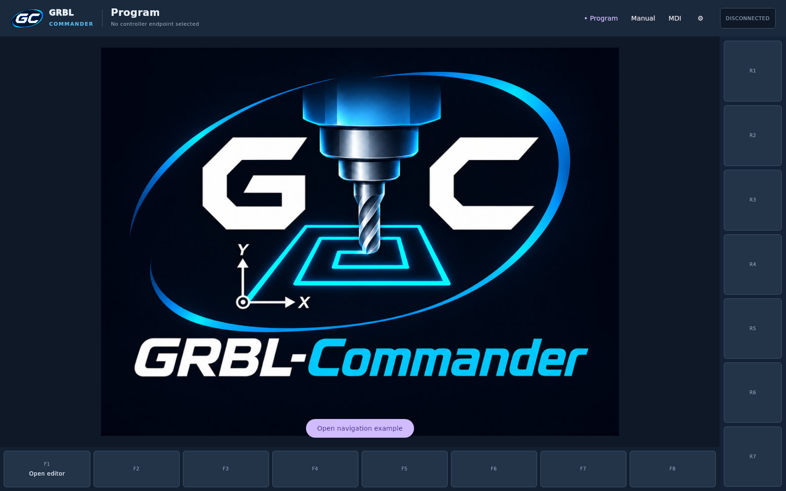
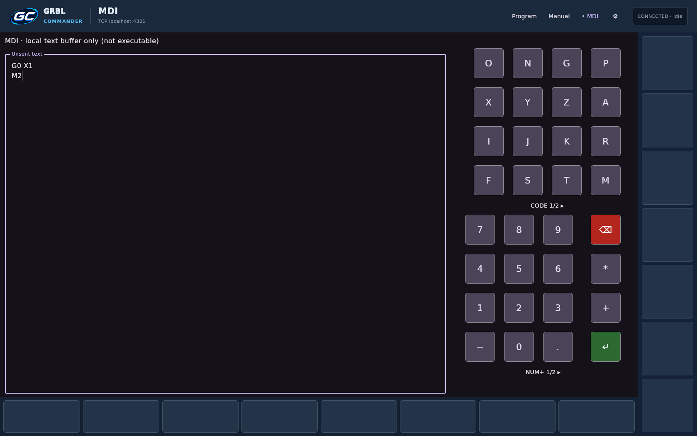
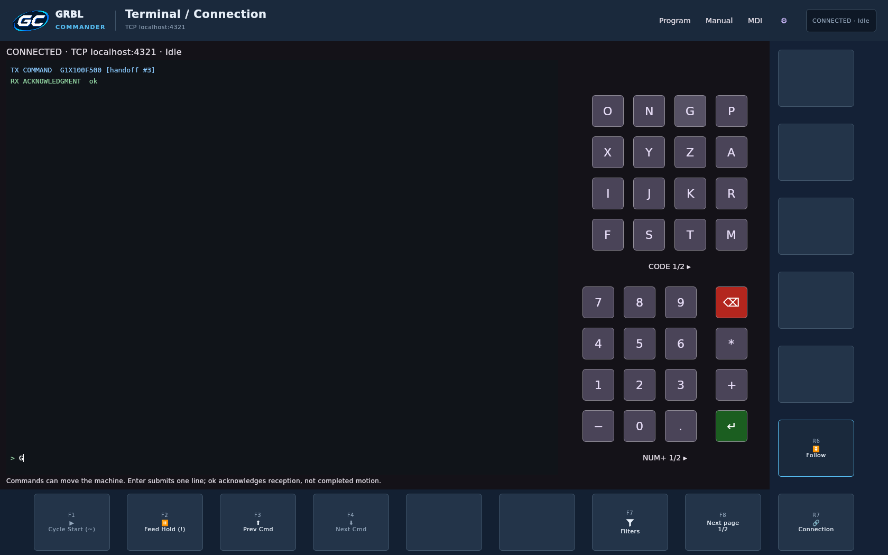
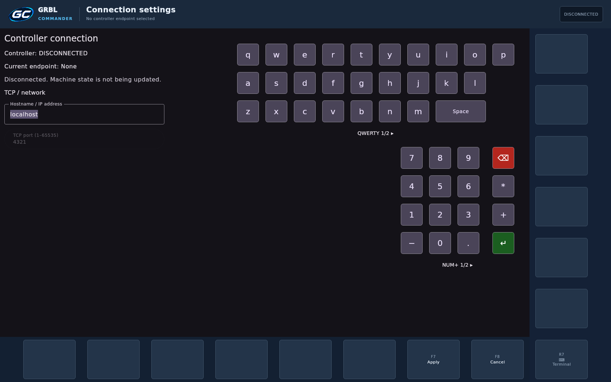

# GRBL Commander

GRBL Commander is a desktop operator interface for CNC machines with
GRBL-compatible controllers, focused on grblHAL. Its touchscreen layout uses
on-screen softkeys and a G-code keypad inspired by industrial CNC controls.



## What you can do

- Connect to a controller over USB/serial or TCP and save the connection settings.
- Monitor controller status and alarms, and inspect live command and response traffic.
- Send individual G-code commands from the Terminal using a physical or touch
  keyboard. The Terminal also offers Feed Hold, Cycle Start and Soft Reset.

MDI edits and runs a temporary G-code buffer. It shows controller-reported
execution separately from the line selected for editing. Program and Manual
currently demonstrate local workflows. Program file access, program execution
and jogging are planned.

| MDI | Terminal | QWERTY keypad |
| --- | --- | --- |
| <a href="https://raw.githubusercontent.com/skasti/grbl-commander/pr-assets/main/mdi/1680x1050.png"></a> | <a href="https://raw.githubusercontent.com/skasti/grbl-commander/pr-assets/main/terminal-idle-first-letter/1680x1050.png"></a> | <a href="https://raw.githubusercontent.com/skasti/grbl-commander/pr-assets/main/connection-host-input/1680x1050.png"></a> |

## Install and launch

Linux and Windows are supported. Use a display with at least 1024 × 720 pixels at
100% scaling. The installers include a Java runtime. USB/serial
connections may require a driver. On Linux, your user needs permission to open
the serial device.

Download the installer for your system from the
[latest release](https://github.com/skasti/grbl-commander/releases/latest).

| Platform | Install | Launch |
| --- | --- | --- |
| Debian or Ubuntu (x86-64) | Run `sudo apt install ./<downloaded-file>.deb` with the actual filename. | Open **grbl-commander** from the application menu or run `/opt/grbl-commander/bin/grbl-commander`. |
| RPM-based Linux (x86-64) | On systems with DNF, run `sudo dnf install ./<downloaded-file>.rpm` with the actual filename. | Open **grbl-commander** from the application menu or run `/opt/grbl-commander/bin/grbl-commander`. |
| Windows (x86-64) | Open the `.msi` and follow the installer prompts. Windows may show an unknown-publisher warning because the package is unsigned. | Open **GRBL Commander** in the Start menu. |

To connect, open **⚙ Util → R7 Connection**, choose Serial or TCP, enter the
controller's connection details, and select **F6 Connect**. See the
[connection form guide](docs/controller-connection.md#connection-form) for
settings and navigation.

### Run from source

Install the [build prerequisites](docs/testing.md#prerequisites), then run this
command from the repository root.

```sh
gradle :app-desktop:run
```

## Safety and license

Commands can move the machine. An `ok` response acknowledges a command.
Check the controller and machine to determine whether motion has finished.
Use the machine's independent physical emergency stop in an emergency. See
the [machine safety constraints](docs/architecture.md#design-constraints).

GRBL Commander is source-available under the
[PolyForm Noncommercial License 1.0.0](LICENSE.md). Its terms permit hobby use, other
noncommercial purposes, and use by the organizations listed in the license. The
license also covers modification and redistribution for permitted purposes,
subject to its notice and distribution terms.

Commercial use outside those terms, including internal use in a
commercial workshop, requires prior permission from the maintainer. Bundled
software has its own licenses. See the
[third-party notices](app-desktop/packaging/common/THIRD_PARTY_NOTICES.txt).

Required Notice: Copyright 2026 Stig-Rune Skansgård.

## Further documentation

- [Desktop UI layout](docs/ui-layout.md) · [Controller connection and settings](docs/controller-connection.md) · [Terminal](docs/terminal.md)
- [Architecture and system guides](docs/architecture.md) · [grblHAL alarms](docs/grbl-alarms.md)
- [Building and testing, including the simulator](docs/testing.md) · [UI screenshots](docs/ui-screenshots.md) · [Release process](docs/releases.md)
- [Repository instructions](AGENTS.md)
