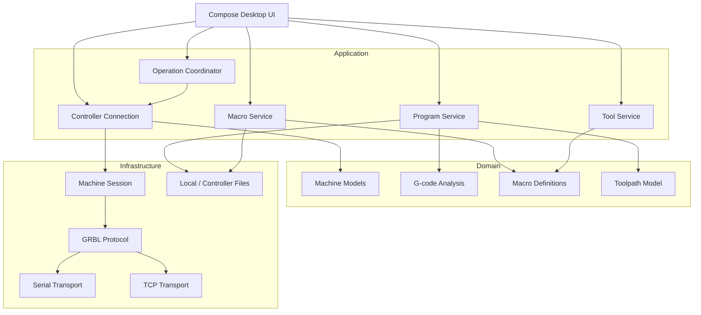

# GRBL Commander — Architecture

## 1. Overview

GRBL Commander is a cross-platform desktop application for operating CNC
machines controlled by GRBL-compatible firmware, with particular emphasis on
grblHAL and its extensions.

The application provides a touchscreen-oriented operator interface inspired by
conventional industrial CNC controllers such as FANUC, Haas, Heidenhain, and
Siemens.

GRBL Commander is responsible for presenting machine state, interacting with the
operator, managing programs and macros, and coordinating communication with the
CNC controller.

**The CNC controller remains responsible for motion planning, real-time motion
execution, machine I/O, and controller-side macro execution.**

The architecture prioritizes:

- Reliable and predictable machine control.
- Clear separation of responsibilities.
- Touchscreen operation with consistent controls.
- Support for grblHAL extensions without depending on a particular firmware
  configuration.
- Reuse of functionality across operating modes.
- Extensibility without introducing unnecessary abstraction.
- Testability without requiring physical CNC hardware.

GRBL Commander supports Linux and Windows as its verified desktop targets. Linux
is the primary development, integration, and deployment focus, particularly for
dedicated touchscreen CNC computers. Cross-platform compatibility across these
supported targets is an architectural requirement. macOS is not tested or
distributed as an officially supported platform.

## 2. Architectural Style

GRBL Commander uses a **modular monolithic architecture**, with explicit
boundaries between UI, application logic, machine communication, and G-code
processing.

A single desktop process is sufficient for the initial implementation.
Components should be separated through packages and interfaces rather than
independently deployed services.

The primary architectural layers are:

1. **Presentation** — Operator interface and UI state.
2. **Application** — Use cases, workflows, and operation coordination.
3. **Domain** — Machine-independent models and rules.
4. **Infrastructure** — GRBL protocol, transports, file storage, and external
   integrations.

Dependencies should point inward toward domain abstractions. UI components must
not communicate directly with serial ports or construct protocol-specific
command sequences.

### Component overview

The diagram illustrates responsibilities and dependencies, not necessarily
separate Gradle modules or runtime processes.

## 3. Machine Communication

### 3.1 Transport

Communication with the CNC controller is abstracted behind a transport
interface.

Initial implementations:

- Serial/USB transport.
- TCP transport where supported.

A transport handles establishing a connection, reading and writing bytes,
connection lifecycle, and transport errors.

It has no knowledge of G-code semantics, controller state, or UI modes.

### 3.2 GRBL Protocol

A protocol implementation translates between controller-specific messages and
application-level operations.

Responsibilities include:

- Parsing status reports, acknowledgments, errors, alarms, and controller
  messages.
- Sending ordinary commands and real-time commands.
- Correlating responses with queued requests where the protocol permits.
- Managing command transmission and flow control.
- Retrieving settings, coordinate offsets, modal state, and other information.
- Discovering controller capabilities and supported extensions.

**All protocol writes must pass through a single coordinated communication
component.**

Normal G-code commands, program streaming, status polling, and real-time
commands have different transmission requirements. Real-time commands must not
be blocked behind ordinary queued G-code.

The implementation must distinguish command acknowledgment from completion of
the corresponding machine operation.

### 3.3 Controller Compatibility

The primary implementation targets grblHAL.

Support for other GRBL-compatible firmware should be possible through capability
detection and protocol-specific behavior, without weakening grblHAL
functionality.

Capabilities may include:

- Supported axes and coordinate systems.
- Tool tables.
- G65 macros and expression support.
- Controller-hosted files and SD storage.
- Tool change protocols.
- Probing and tool setters.
- Additional status report fields.
- Controller-specific commands and extensions.

A feature must not be presented as available merely because it exists in
upstream grblHAL. Availability depends on the connected controller, firmware
build, driver, and enabled plugins.

### 3.4 Machine State

The application maintains an observable representation of the latest confirmed
controller state.

This includes:

- Controller execution state (`Idle`, `Run`, `Hold`, `Jog`, `Alarm`, etc.).
- Machine and work positions.
- Active work coordinate system and offsets.
- Feed and spindle state and overrides.
- Active and selected tools.
- Homing and probe input state.
- Connection health and freshness of reported data.
- Available controller capabilities.

Machine state is exposed as immutable snapshots through Kotlin `StateFlow`.

The controller is authoritative. Locally predicted positions or operation
outcomes must never silently replace confirmed controller observations.

Disconnected or stale values must be visibly distinguished from live values.

### 3.5 Implemented communication API

The `MachineTransport` contract
defines a one-shot byte connection. `TcpTransport` implements cancellable
non-blocking TCP with bounded connect/write timeouts, EOF detection and
idempotent close. `SerialTransport` uses jSerialComm with explicit port, baud,
data/stop bits, parity, flow control and DTR/RTS configuration. Non-blocking
serial reads/writes allow cancellation and bounded write deadlines; native open
is dispatched to the I/O pool. USB disconnect notifications invalidate the
transport. `MachineTransport.isConnected` reports whether the transport is known
usable; it is not proof of controller responsiveness. Cancelling or timing out a
write preserves a usable connection but can leave a partial/uncertain write;
actual I/O failures close it before propagating. Local argument rejection sends
no bytes. Native driver calls may delay cancellation until the driver returns.
Serial lifecycle tests use an injected native adapter; physical ports are not
verified. `GrblProtocol` parses acknowledgments, numeric errors/alarms, startup
banners and status reports, retaining optional/unknown fields. Incremental
CR/LF decoding bounds each response line to 4096 bytes. Normal commands are
limited to 120 printable ASCII bytes, excluding embedded real-time bytes.
`MachineSession` defines the application-facing connection, line acknowledgment,
real-time and status-query API. `MachineSnapshot` uses read-only `StateFlow` and
retains the observation timestamp and explicit connection health.
`GrblMachineSession` owns one transport and one reader. It connects by requesting
status (`?`) until a report arrives within a bounded handshake deadline; it
never resets, unlocks or resumes a controller implicitly. Firmware startup-block
acknowledgments, NVS errors and alarms received during this status-only
handshake are retained as diagnostics, not correlated with commands. A reported
Alarm state is a valid connection result, not permission to move. Normal lines are
serialized with one acknowledgment outstanding. `CommandAcknowledgment` reports
acceptance or an error code, plus information lines observed during that request;
these lines may include unsolicited controller notifications. It is not an
operation-completion result. Real-time writes bypass normal admission and its
acknowledgment wait; writes are serialized per bounded line/real-time byte,
without holding the write lock during the acknowledgment wait.

Alarm state, transport health and ordinary command correlation are independent.
`ALARM:n` and optional `Alarm:n` status substates populate `alarmCode` and the
computed `alarm` descriptor (category, exact core criticality and guidance).
Unknown numeric codes retain unknown criticality. Explicit `$EA` output supplies
controller/extension descriptions when available; the metadata cache is bounded
to 512 entries. No catalog query, unlock, homing or reset is automatic.

Core-critical codes are exactly 1, 2, 10, 17 and 20. A critical event can discard
a line without acknowledgment. The session fails active/queued normal work and
sets `resetRequired`, without waiting for a late `ok` and without closing a usable
transport. Ordinary writes remain prohibited even if an unrelated acknowledgment
or a status report arrives. Unknown numeric extension alarms require the same
conservative reset boundary, without being labelled core-critical. A bare Alarm
with no known code blocks normal writes until identified or explicitly reset.

Non-critical alarms interrupt an active line and invalidate already queued lines.
A transmitted line retains its response slot: `normalCommandsSynchronized` is
false until that line's late `ok`/`error` is consumed. The same applies to a
normal-command timeout, cancellation, response-collection overflow or uncertain
write. If no response arrives, `reset()` provides an explicit recovery path.
An alarm with no outstanding line creates no response expectation; a
non-critical alarm such as homing-required (11) permits explicitly requested
`$H` through the normal API. Repeated reports of the same Alarm state do not
interrupt that request. An `ok` does not establish homing or operation completion.
Local rejection/cancellation before write admission preserves other queued work.
A regular `error:n` rejects only its own line.

`reset()` (also used by `sendRealtime(SOFT_RESET)`) sends one explicit reset byte
on the existing transport, invalidates pending/queued work and waits under a
bounded deadline for the initialization banner and a subsequent status report.
Pre-banner statuses and acknowledgments cannot restore synchronization. The
banner is the core's parser/input-buffer reset boundary; it discards old response
expectations without replay. The session never opens another transport, retries
the reset, unlocks or homes. `resetInProgress` describes this handshake separately
from `connection`. A timeout or uncertain reset write leaves control/status
available but normal work blocked; the operator may clear the cause and request
another reset. A known unsent local reset rejection preserves existing work.
Unexpected initialization also preserves transport/control but requires explicit
session recovery before admitting normal work.

A critical alarm code may remain reported after reset has exited the blocking
loop. Therefore alarm criticality is not equivalent to `resetRequired`. A
retained, known pre-reset code after a confirmed reset boundary does not itself
demand a second reset, including when a bare Alarm report precedes its substatus.
This exception ends on a non-Alarm status, a changed alarm code or an explicit
`ALARM:n` event. A subsequent alarm transition is handled as a new event, even
when it repeats the pre-reset code. New critical alarms, `ALARM:n` events with
critical/unknown codes or critical-blocking status reassert the restriction.
Absence of `$C:1` does not identify a reported alarm as retained.
In grblHAL all-fields reports, `FW:grblHAL` identifies the report that includes
`$C:1` while the blocking event is active; `ControllerStatus.blockingCriticalEvent`
exposes this observation when available. `STATUS_QUERY_ALL` (0x87) requests these
fields as a grblHAL extension. Ordinary `?` status remains supported without
assuming that extension exists on every GRBL-compatible controller.

Status and real-time writes bypass normal admission and acknowledgment waits;
the controller determines which controls it processes in each state. Critical
loops continue status/reset handling but must not be assumed to execute Feed
Hold, Cycle Start or overrides normally. No real-time error is retried.
Recoverable/local errors and cancellation preserve a usable transport and are
reported separately in `lastRealtimeFailure`; actual I/O loss and reader/framing
failure mark the connection FAILED. A missed status response alone does not
close a usable transport. Consumers must check `reportedAt` and connection health
before treating retained observations as live. Close cancels owned coroutines;
`awaitClosed()` joins them. Parent cancellation closes the owned session.

There is no generic resynchronization guarantee from status, an empty line or a
diagnostic request: ordinary responses have no request IDs. Unsolicited
acknowledgments with no owner require explicit reset. See
[grblHAL alarm protocol](grbl-alarms.md) for categories, recovery considerations,
pinned source findings and simulator versus in-memory verification coverage.
Capability discovery, streaming and application operation workflows remain planned.

### 3.6 Application connection ownership

`core.connection.ControllerConnection` is the UI-independent application
boundary in `:core`. `Main` in `:app-desktop` creates one connection owner and
one `ControllerSettings` instance above the window/mode stacks, passes them into
presentation, and explicitly closes and awaits the connection when the
application exits. `CommanderApp` supplies the same owner to every retained
mode through `LocalControllerConnection`, and displays its connection health in
the header. Screens never construct sessions or transports.

`ControllerEndpoint.Tcp(host, port)` and `ControllerEndpoint.Serial(configuration)`
select `TcpTransport` and `SerialTransport` through a small factory. Serial uses
`SerialConfiguration` unchanged, including its 115200/8N1/no-flow-control/DTR/RTS
low defaults. Native serial-port lookup occurs at connect rather than endpoint
selection. `ControllerEndpointDraft` validates editable fields without DNS lookup
or I/O. TCP uses an explicitly entered port (1–65535); serial retains the existing
defaults and permits manual Windows port names and Linux device paths, including
devices absent from discovery.

`ControllerSettings` in core owns the observable saved `configuration`, separate
from the active session endpoint and a screen's unsaved draft. Its load/save
workflows serialize configuration access, validate loaded/edited values and
publish configuration after a successful read/write. Loading occurs through the
core operation at application startup and when the form opens. Main owns connection
and settings above screen lifetimes, launches `initialize()` and cancels/joins its
application scope at shutdown. The desktop entry point uses
`application(exitProcessOnExit = false)`: window close returns through Main's
`finally` block instead of terminating the JVM before cleanup. Main cancels the
application scope, calls `connection.close()`, awaits `connection.awaitClosed()`
and joins the application job. This disposes TCP/serial resources, stops polling
and cancels pending handshake/command work before normal process completion;
uncertain commands are never replayed. No machine reset, hold or unlock is sent
as part of exit. `CommanderApp` signals `onUiReady()` after composition.
Core initialization loads configuration and asynchronously attempts a valid saved
endpoint at most once. Missing/invalid data skips connection. Manual actions cancel
pending initialization; direct connection lifecycle intentions also prevent delayed
automatic replacement. Automatic/manual attempts share the connection lifecycle lock.
There is no retry, reset, unlock or automatic navigation. Startup failure updates
core connection state and the header only; settings can inspect its details.
Connect validates and awaits handshake before persisting its endpoint inside
core; presentation invokes user intentions and never performs this internal save.

`ControllerEndpointRecord` in core maps typed endpoints to/from the versioned
Properties text. Missing, incomplete, invalid or unsupported records leave the
endpoint unselected and retain normal serial defaults. Infrastructure's
`configuration.ControllerEndpointPreferences` reads/writes that opaque text using
JVM per-user preferences, at node `no/grblcommander/controller`, key `endpoint`.
The v1 field names and representation are stable; storage does not interpret or
validate endpoint models. This small string boundary keeps infrastructure
independent of core without duplicating models or introducing a repository
framework. Storage/flush failures propagate through core; core dispatches storage
I/O and saving never reconfigures or connects a session.

`SerialPortDiscovery` in `:infrastructure` enumerates jSerialComm ports on the I/O
dispatcher, returning device paths/names and descriptive labels without opening
ports or changing control lines. Empty discovery and native/permission failures
are distinct results; cancellation propagates. Discovery is advisory, so manual
device entry remains valid independently of its result. Presentation requests
discovery through `ControllerSettings.discoverSerialPorts()`; the native adapter
and enumeration remain in infrastructure.

`ControllerSettings` validates and orchestrates explicit load/save/connect/disconnect
requests through the existing owner. Replacing or disconnecting a connected or
connecting session requires explicit interruption confirmation. Save cannot
reconfigure an active session. Connect saves only after successful handshake;
a subsequent storage failure leaves connected health visible. Cancellation during
handshake closes the unfinished attempt; disconnect remains available during it.
The settings screen tracks its one active job as Save, Connect or Disconnect.
The application reports handshake completion before persistence begins, so this
phase does not depend on later connection-health changes. Disconnect can replace
only Connect, awaiting cancellation/cleanup of an unfinished
handshake, or awaiting its settings save if handshake has completed. Save and a
running Disconnect cannot be cancelled by another Disconnect action. Workspace
buttons and softkeys share the same enabled predicate, and callbacks also guard
against repeated activation. Interruption still requires explicit confirmation.
Connection attempts and machine commands are not automatically retried; no
reset, machine command replay or auto-connect is implicit.

The Util mode owns one persistent stack rooted at `Terminal : Screen<Unit>`.
`ControllerConnectionSettings` opens above it with the explicit parent contract.
R7 opens Connection from Terminal and returns to Terminal from the form. No
self-selection key is shown on Terminal. F8 cycles between the Cycle Start/Feed Hold/command-history
and reset/copy/clear bottom pages. R6 ⏬ Follow remains available on both pages
and in Filters. F7 Filters, with a funnel icon, replaces the
bottom bank with F1–F6 filter toggles and F7 Back. Back restores the selected
ordinary page; R7 navigation remains available while filtering. F5/F6 are
unassigned on the ordinary terminal pages.
The workspace has no action toolbar or explicit status-query key. Settings replaces
both softkey banks, so Terminal actions cannot leak through. Screen instances and
compositions retain terminal draft/caret, filters, scrollback and open forms across
mode changes. The form owns draft, validation/error display and stack-owned
interruption confirmation, never a session. Closing the form cancels unfinished
form work; a completed connection outlives the screen.

`ControllerConnection.executeLine` validates with the existing protocol encoder
and reserves a single manual command slot before dispatch. Admission requires a
fresh connected, synchronized Idle/Alarm/Check report, no reset boundary and no
other pending manual command; the session remains the final protocol/alarm gate.
This prevents normal terminal commands during externally running work. The slot
ends on acknowledgment or failure, never represents completed physical motion and
is not transferred across sessions. `sendRealtime(CYCLE_START)` independently
rechecks a fresh synchronized `Idle` or `Hold:0` report, with no alarm, closing
connection or reset boundary. The same predicate drives the terminal softkey.
Acknowledgment is not motion completion: explicit Cycle Start can resume a
completed Feed Hold even after the line's acknowledgment or for externally initiated
work. It sends one realtime `~`, without resubmitting a command or predicting
execution state. Run, Hold:1 (deceleration), Jog, Door, Alarm, missing/unrecognized
status and stale/disconnected reports are rejected. No diagnostic handoff or
pending-line ownership is required for this operator action. Program execution
and broader operation coordination remain planned. Status, Feed Hold and Reset
remain independent of normal-command admission.

Both header and form read the same authoritative owner state. A presentation clock
marks retained reports stale after three seconds, even without a new state emission;
disconnected/unknown reports are not live.

Each active connection owns one core background polling coroutine, independent
of UI composition and mode selection. After successful handshake it waits 500 ms
and sends `RealtimeCommand.STATUS_QUERY` through the existing session realtime
writer. It does not await a response or hold the explicit `queryStatus()` mutex;
the single session reader handles every report. Normal-command acknowledgment
slots and traffic categorization are unchanged. Polling waits 500 ms after each
write completes, so slow writes cannot overlap or create catch-up bursts.

Polling pauses while `resetInProgress` because reset owns its status handshake.
Alarms, `resetRequired` and uncertain normal-command correlation do not block
status requests. Recoverable write failures/timeouts retain the session's existing
diagnostics and permit the next scheduled poll; cancellation propagates. Actual
connection failure stops polling, and disconnect/reconfiguration/replacement or
application/parent shutdown cancels and awaits the old connection's polling work.
A reconnect creates one fresh loop only after disposing the old session. No
normal command, reset, reconnect or status-derived success is synthesized;
missing responses remain visibly stale.

The owner starts disconnected. `connect(endpoint)` is an explicit operator
request: it closes, cancels and awaits any old session/handshake before creating
a fresh one-shot session. `disconnect()` can interrupt a pending connection.
`reconfigure(endpoint)` disposes the existing connection and selects the endpoint
without opening it. Failed/cancelled handshakes clean up; another connection
requires an explicit request. Disposal completes under cancellation protection,
including clearing the active reference and publishing disconnected health with
`closing = false` (or closed health during application shutdown). A cancelled
replacement/reconfiguration cannot leave an inactive owner stuck closing; the
selected endpoint remains available for a subsequent explicit action. There is no implicit reconnect, reset, unlock,
homing, command replay or resumption. The owner forwards `executeLine`,
`sendRealtime`, `reset` and `queryStatus` to its single session without changing
admission, priority, correlation or uncertainty semantics. Pending lines fail on
disposal and their controller outcome must not be assumed known.

`ControllerConnectionState` exposes the selected endpoint, the authoritative
`MachineSnapshot` and a closing flag. Transport health, controller execution
state, command synchronization and report freshness remain separate. A retained
snapshot after disconnect is an observation, not live machine state. Explicit
disconnect/reconfiguration/shutdown clears the application-level failure field;
the session's technical close reason is not a connection error. State observers
do not publish session-close diagnostics while the application owner is closing.
Unexpected failures remain visible until an explicit lifecycle action acknowledges
them; navigation alone never clears errors. The owner
and session are explicitly disposable; `awaitClosed()` joins owned work.

### 3.7 Passive communication diagnostics

`MachineSession.communication` is a read-only `Flow<CommunicationEvent>`
observed at the existing coordinated session I/O boundary. No observer reads the
transport or owns acknowledgments. The reader retains each original nonempty
decoded line alongside the parsed category: status, acknowledgment, error, alarm,
startup or information (including unknown extensions). Normal TX retains its
exact encoded line including LF; realtime/status bytes are rendered as printable
ASCII or `0xNN`. Each event has a session-local sequence and `Instant` timestamp.

TX `ATTEMPTED` means handoff to the transport, never delivery, acknowledgment or
motion completion. A failed handoff emits a related event referencing the attempt:
`LOCAL_REJECTION` guarantees no bytes were sent under the transport contract;
`UNCERTAIN` covers cancellation, timeout and I/O failure, including possible
partial writes. Session validation/admission rejection has no TX event. A write
that returns normally remains an attempt observation; normal `ok`/`error` remains
a separate RX event owned by the existing session correlation logic.

The session retains a bounded replay buffer (256 events by default) backed by
`MutableSharedFlow` with `DROP_OLDEST` and non-suspending `tryEmit` publication.
A stalled subscriber cannot cause the latest event to be rejected for responsive
subscribers. Each subscriber resumes with the recent tail; sequence gaps show
which observations it missed. `recentCommunication` exposes a read-only snapshot
of that bounded tail without subscribing or changing controller state.

`droppedCommunicationEvents` counts each source event evicted before handoff to
at least one active subscriber once, even if several subscribers missed it. It
is updated at publication, including the last overflow before traffic stops;
subscriber resumption is not required. One next-sequence cursor per active
subscription supplies this information because `DROP_OLDEST` always accepts
`tryEmit`. Cursor registration/removal and advancement share the short publication
lock; subscriber code runs outside cursor bookkeeping. A value taken from the
backing flow but evicted before cursor advancement is skipped rather than handed
out after being counted as lost. Collection uses the supported `flow` builder,
not inheritance from the unstable `SharedFlow` interface. No rejected-delivery
queue, per-subscriber event buffer or transport reader is introduced.

A global overflow count can reflect a stalled terminal while the application
history receives every event. Replay eviction without subscribers and ordinary
history retention are not subscriber overflow. Observation never changes
controller state, normal admission, status parsing, priorities or alarm handling.

Core subscribes before connecting, capturing handshake traffic. `traffic` is a
read-only `SharedFlow<ControllerTraffic>` backed by `MutableSharedFlow` with 1,024
extra slots, `DROP_OLDEST` and `tryEmit`. Publication never suspends machine I/O;
successful `tryEmit` does not imply every subscriber received every event.
A separate 5,000-event deque retains all observed traffic regardless of UI filters.
`diagnosticSnapshot()` copies it consistently only on explicit request. Entries
carry endpoint, session identity, source sequence, timestamp and global cursor.
The cursor advances by source sequence distance across sessions, so a consumer's
cursor gaps count the union of upstream and core-stream loss once. Multicast-wide
drop counters describe other subscribers too and must not be added to these gaps.
Normal diagnostic retention is not loss. Disconnect and awaited shutdown collect
the remaining session replay tail without duplicate session/sequence identities.

Terminal continuously subscribes while its retained screen is composed, including
inactive modes and covered Connection settings. Subscription is established before
seeding from the diagnostic snapshot. Cursor overlap is ignored; bounded overflow
during handoff remains detectable. The snapshot's oldest retained cursor establishes
the initial baseline, without warning about earlier normal diagnostic rotation.
Terminal owns a 10,000-entry Compose-observable indexed ring. Only events admitted
by current filters consume capacity; all events advance its loss cursor and update
command recall. Filter changes do not delete or reconstruct existing entries.
Slots and ring indices update atomically on the desktop UI dispatcher; ingestion
yields after bounded work, and LazyColumn renders retained entries with stable
session/sequence keys. Normal rotation is silent. Clear view advances a local
boundary and clears only displayed rows. Persistent/file logging is not implemented.

Command recall observes ordinary command TX handoffs independently of acknowledgment.
Local transport rejection removes its exact session/attempt entry; controller error,
timeout and uncertain handoff retain it. The command operation still awaits its
acknowledgment. No synthetic TX echo, automatic retry or replay is introduced.

## 4. Application Operations

Application operations represent user intentions rather than raw protocol
commands.

Examples:

- Home machine.
- Jog an axis.
- Set a work coordinate.
- Execute an MDI buffer.
- Start or resume a program.
- Run a macro.
- Read controller settings.
- Synchronize macros.

The **Operation Coordinator** is responsible for:

- Validating operation preconditions.
- Preventing conflicting operations.
- Managing operation ownership and lifecycle.
- Dispatching commands through the machine session.
- Monitoring controller state.
- Reporting progress, completion, failure, and interruption.

Only one operation that owns machine motion or program execution may be active
at a time. Monitoring and permitted real-time controls remain available
independently.

An operation must not be considered complete solely because its final G-code
block received an `ok` response.

Program streaming, controller-hosted execution, and macro execution may require
different completion and progress strategies.

### 4.1 Global Controls

Cycle Start, Feed Hold, Reset, and overrides are application-wide operations.

Their behavior depends on the active operation and actual controller state, not
solely on the currently displayed UI mode.

For example, Cycle Start may start a prepared MDI buffer, start a selected
program, or resume an operation held by the controller.

The UI must clearly distinguish starting a new operation from resuming an
existing one.

### 4.2 Jogging

Jogging uses the controller's dedicated jogging protocol when available.

Both incremental and continuous jogging are supported.

Continuous jogging must account for touch release, cancellation, application
focus loss, connection interruption, and delayed input events. Its safety must
not depend exclusively on receiving a touch-release event.

### 4.3 Operator Interaction

Controller messages and state transitions may require operator intervention,
particularly during tool changes and macros.

The application provides a centralized operator-interaction system for:

- Informational messages.
- Warnings and alarms.
- Program pauses.
- Tool change instructions.
- Actions requiring explicit operator confirmation.

Messages are not automatically interpreted as blocking requests. Resumption and
acknowledgment must follow the controller's actual protocol and state.

## 5. User Interface

The user interface is implemented with **Compose Multiplatform Desktop**.

It is designed primarily for touchscreen use while retaining keyboard and mouse
support.

### 5.1 Persistent Layout

The main screen consists of:

- **Mode Header:** Active application mode and controller status.
- **DRO:** Machine position and active work coordinate position.
- **Workspace:** Content specific to the selected mode.
- **Right Softkeys:** Mode-common and contextual actions resolved from the
  active screen stack.
- **Bottom Softkeys:** Context-dependent actions resolved independently from the
  same stack.

Softkeys use shared components and a common action model. Their labels, enabled
states, and actions are determined by the active mode, dialog, and machine
state.

Shared operations can use consistent positions where appropriate screens expose
them; no softkey is unconditionally visible across modes or overlays.

**Current implementation:** The desktop shell renders a header with Program,
Manual, MDI and icon-only Util UI-mode selection, a central workspace, eight bottom softkey
slots and seven right softkey slots. Each window retains a `ScreenStack` for
each UI mode, hosted together by `ScreenStackHost`. Program includes the branded
welcome screen and a runnable in-memory editor/file-explorer example. Manual has
a nested details screen with local notes; MDI has an unsent text buffer. Util has
a live interactive Terminal root and controller connection settings. Mode
changes do not cancel overlays, discard drafts, or alter controller execution
state. The window icon and header show the supplied app logo. Softkey slots
render screen-owned labels/icons, reactive enabled/active state, and safe
in-memory navigation actions. Pointer and keyboard input share guarded slot
activation. DRO and Program/Manual/MDI execution workflows are not implemented. A shared core-owned connection coordinates `:infrastructure`; the
header observes its real health and report freshness. Core attempts a valid saved
endpoint once after UI readiness; Util owns explicit connection settings/actions. The shared slot layout is described
in [UI layout](ui-layout.md).

### Screen navigation contract

Presentation defines `NavigationParent`, `Screen<R>`, `ScreenStack` and
`ScreenStackHost` in the desktop `ui.navigation` package. Both `Screen<R>`
and `ScreenStack` implement `NavigationParent`; `screenStack` returns the
owning stack. A root screen is bound by `ScreenStack(root)` after construction,
so the root never needs its stack while being initialized. Other screens are
bound by the stack when opened or pushed, and unbound on removal.

A screen owns its UI in `Content()`, its state, a typed cancellation value,
and `open(parent, onResult)` / protected `finish(result)` methods. A plain
screen uses `Screen<Unit>(Unit)` without a dedicated result class. The
`FileExplorer` screen uses `FileExplorerResult.Selected(filename)` and
`Cancelled`. `ScreenStack` owns instance identity, observable stack changes,
screen attachment lifetimes, root protection, guarded completion and
at-most-once callback delivery.
Ordinary `pop()` and `dismiss()` deliver the screen's cancellation result;
completion and cancellation restore the underlying screen before the callback
runs. A covered screen cannot open or finish another screen. Opening with the
stack itself as parent is an explicit direct navigation action that adds above
the current top, even when overlays are present. Independent stacks never share
navigation bindings or a global navigator.

`ScreenStackHost` accepts a single `ScreenStack` or several stacks with one
designated active stack. Each hosted stack retains its root-to-top screen
compositions, including covered overlays. In multi-stack hosting it draws only
the active stack and restricts pointer, keyboard, focus traversal and
accessibility interactions to that stack's top screen. An inactive stack
cannot request focus; activation clears stale focus and focuses the current
top screen. Switching the active stack does not alter any navigation entries
or pending typed callbacks. Every screen retains ordinary Compose `remember`
state, not merely screen-instance fields. `CommanderApp` creates the stacks
once per application window and keeps the active UI-mode selection in Compose
state; there is no mode-specific navigation registry or globally shared host.

Reusable `ui.dialogs.ModalDialog<R>` screens render a message and map supplied
bottom-softkey choices to typed results. They open above an explicit parent in
its existing stack, replace both key banks and rely on the host for the scrim,
input isolation and retained compositions. There is no global dialog navigator,
native modal window or separate result mechanism. Dialog content has no action
buttons; the shell renders the choices. Connection interruption uses F1 confirm
and F8 cancel, with the parent restored before it processes the decision through
core. Generic dialog presentation has no connection/core dependencies.

Header and softkey regions remain owned by `AppShell` outside workspace input
boundaries. Navigation is observable through Compose snapshot state and confined
to the UI thread; it does not create transports or modify controller execution
state. Visual overlay layout and input isolation are independent of softkey
inheritance. Screens own stable typed bottom/right maps of immutable
`SoftKeyDefinition`
or `SoftKeyModifier` overrides in `ui.navigation`. Definitions carry bound
instance
callbacks and reactive enabled/active predicates; `Blank` is empty and
non-actionable. Modifiers transform definitions without a central action
registry.
`ScreenStack.softKeyDefinition(slot)` derives the effective definition for a
slot from the active retained screen sequence. `Screen<R>` declares independent
`inheritBottomKeys` and `inheritRightKeys` flags, both false by default.
For each bank, traversal starts at the top and stops at the first screen not
inheriting that bank, or at the root. Overrides compose bottom-to-top within
that boundary: complete definitions (including `Blank`) replace bindings;
modifiers transform a current definition, but are ignored for missing slots.
The `ui.navigation` package exposes `definitions()`, `applyOverrides()`, and
`applyAllOverrides()` map extensions for composing these screen-owned maps.
`effectiveBottomKeys` and `effectiveRightKeys` are read-only
`derivedStateOf` views for `AppShell` rendering, recalculated only for
structural state changes. `softKeyDefinition(slot)` reads from these same
effective bank views for activation, so the displayed and invoked definition
come from the same observable binding. Structural changes to labels, icons,
actions, or overrides must use a `mutableStateMapOf` or a map-valued getter
backed
by `mutableStateOf`. Ordinary mutable maps and non-state property assignments do
not notify Compose and are unsupported for changing softkeys because the UI can
remain stale. A screen ordinarily keeps its definitions stable and lets
predicates read observable state. `AppShell` renders all fixed slots through one
shared tile component. It evaluates predicates in composition so Compose
snapshot changes update presentation without rebuilding definitions. The bank
derivations observe structural changes without maintaining a separately mutable
binding store.
`ShellState` contains only header information, not softkey state.

`activateSoftKey` reads the currently selected persistent stack and slot,
checks the current definition's action and `enabled` predicate, and invokes
the bound callback on the UI thread. It does not retain action callbacks or
binding identity. It is valid for an action itself to navigate.
For pointer activation, `SoftkeyTile` uses Compose
`key(stack, entry, definition)`
to dispose the clickable gesture when the active stack, the top navigation
attachment, or the effective definition changes. The `entry` is the existing
navigation entry, not a separate softkey lifecycle. Ordinary predicate-result
changes recompose the presentation without changing the composition key;
activation always evaluates the latest `enabled` result. The shell previews
F1–F8 and Shift+F1–F7 (right bank) before workspace input, using the same
activation path. Mapped key-down events activate and key-up events are consumed;
repeatable definitions also accept repeated key-downs. Terminal realtime controls
set `repeatable = false`, so held keys are consumed until release, including across
navigation changes. Owners independently guard concurrent requests. `active` affects presentation only. No central
action registry, navigator or mutable softkey store is involved.

`SoftKeyPages<S>` is presentation state owned by an individual screen/bank.
Screens expose its current map through the existing softkey getters. Common
navigation keys retain their positions, and a non-repeating Next page action
wraps to the first page. A single page has no paging action. This does not add
navigation entries or a separate action dispatcher. Contextual banks such as
Terminal Filters replace that screen's bottom map without changing the selected
page, input, right navigation key or the controller. Retained compositions preserve page/menu state.

Each retained mode stack owns its effective bindings through its screens. A
covered screen can contribute actions only through inheritance explicitly
enabled by the screens above it. Modifiers retain the originating screen's
callbacks and reactive predicates unless deliberately overridden. The
FileExplorer example replaces the editor's bottom bank but inherits right keys,
disables/relabels an editor action, blanks another, and adds its own Info key.
Pop restores the underlying definitions; switching modes selects a different
retained stack without copying key state.
The Program/Manual/MDI examples are local UI fixtures; real program/file
services and their execution workflows are not implemented. Util Terminal uses
the shared connection for explicit manual commands and realtime controls. Detailed lifetime, root, rendering
and focus behavior are specified in [UI layout](ui-layout.md).

### 5.2 Application Modes

Initial modes:

| Mode       | Responsibilities                                                   |
|------------|--------------------------------------------------------------------|
| Manual/Jog | Jogging, homing, positioning, coordinate setup                     |
| MDI        | G-code input, editing, and execution of a temporary program buffer |
| Program    | Program selection, editing, toolpath preview, and execution        |
| Probing    | Macro-driven probing workflows                                     |
| Macros     | Macro discovery, editing, execution, and synchronization           |
| Util       | Live Terminal, manual commands, realtime controls and connection settings; further diagnostics planned |

Tool Management may be presented as a mode or as a workspace accessible from
Program and Macros.

**Application modes are UI contexts, not controller execution states.**

Switching UI mode must not implicitly modify machine state or interrupt an
active operation. Each window retains its mode stacks and their composed
navigation histories independently. The current demonstration provides Program,
Manual, MDI and Util contexts; probing and macro workspaces remain planned.

### 5.3 DRO

The DRO remains visible in most operating contexts.

It displays the position of every available axis in both machine coordinates and
the active work coordinate system.

Where permitted, coordinates can be edited through context-sensitive actions,
including:

- Set to zero.
- Set to a specified value.
- Halve the displayed coordinate value.
- Apply a relative adjustment.

Editing a work coordinate changes the appropriate coordinate offset. It must not
implicitly request machine movement.

Machine coordinates are read-only during normal operation.

### 5.4 Shared UI Components

Reusable components include:

- G-code editor.
- Touch-optimized G-code keyboard.
- Numeric input and unit-aware controls.
- DRO and coordinate editor.
- Macro parameter dialogs.
- Tool table and tool inventory views.
- Program block navigation.
- Toolpath viewer.
- Confirmation and operator-intervention dialogs.
- Communication terminal.

The implemented touch keyboard lives in `ui.controls`. `GCodeKeyboard` composes
independent `KeyCluster` grids using `KeypadLayout` snapshots and screen-local
`KeyClusterState`. Terminal and MDI consume these generic controls and explicitly
bind editing/Enter to their own inputs. Terminal reuses guarded manual submission;
MDI inserts local newline/EOB without execution. Keymaps and spacing are data;
persistence and a visual keymap editor are not implemented. This presentation
configuration is separate from core-owned controller endpoint settings. Other
listed components remain architectural targets where not described as implemented.

Views consume application state and dispatch typed operations. They do not own
machine communication.

## 6. Programs and G-code

### 6.1 Program Model

A CNC program is a first-class application object.

It contains the original source, ordered blocks, optional file identity, editing
state, and analysis results.

Programs may originate from:

- Local files.
- Temporary MDI buffers.
- Controller-hosted storage.
- Generated or imported content.

MDI and Program modes share the same underlying program model and execution
infrastructure.

### 6.2 G-code Analysis

G-code parsing and analysis are separate from execution.

The analyzer provides:

- Syntax and structural analysis.
- Identification of commands, words, expressions, and macros.
- Modal state tracking.
- Block-to-toolpath associations.
- Static extraction of tool requirements and macro invocations.
- Diagnostics for unsupported or unresolved constructs.

The parser must accommodate grblHAL-specific features, including expressions,
variables, flow-control constructs, and extensions where supported.

**Static analysis is not a substitute for controller-side G-code execution.**

Dynamic expressions, controller variables, macro calls, and conditional
execution may prevent complete static interpretation. The analyzer must
represent uncertainty explicitly instead of producing an apparently complete but
incorrect result.

### 6.3 Toolpath Visualization

Toolpath generation is independent of the UI renderer.

The analysis layer produces geometry and metadata associated with source blocks.

The initial renderer uses Compose Canvas/Skia for 2D and 2.5D visualization,
including axis projections, zoom, pan, rapid/feed distinction, and
selected-block highlighting.

Hardware-accelerated 3D visualization and material removal simulation may be
introduced later behind the same geometry model.

Rendering must distinguish resolved geometry from paths that cannot be evaluated
reliably.

### 6.4 Program Execution

Program execution supports multiple execution strategies:

- Host-streamed G-code.
- Controller-hosted file execution, when supported.
- Single macro invocation.

Each strategy exposes a consistent application-level lifecycle while retaining
its protocol-specific behavior.

Execution progress must distinguish source position, submitted blocks,
acknowledged blocks, and reported controller execution position where available.

## 7. Macro System

Macros are first-class programs executed by the controller whenever the
controller supports the required functionality.

GRBL Commander does not implement a competing interpreter for controller-side
macro logic.

The Macro Service handles:

- Macro discovery and cataloging.
- Source editing.
- Macro metadata and parameters.
- Invocation construction.
- Local/controller version comparison.
- Synchronization and backup.
- Associations with application functions and UI categories.

### 7.1 Macro Definitions

Macro interfaces are determined by the macro implementation and the controller's
supported argument-passing conventions.

For example, a `G65 P200` invocation follows the interface expected by
`P200.macro`, regardless of whether the caller is a Fusion postprocessor,
another macro, or the user interface.

Optional metadata describes how a macro should be presented:

- Display name and description.
- Category.
- Parameter names, types, units, defaults, and constraints.
- Available operator actions.
- Supported machine configurations.

Metadata may be stored in sidecar files or derived partially from source
comments and static analysis.

The source macro remains executable without GRBL Commander or its metadata.

### 7.2 Macro-Driven Workflows

Probing and tool-related functions are primarily composed from controller
macros.

A generic macro parameter UI can generate operator dialogs without hardcoding
individual probing operations.

Complex workflows, including tool changes and tool-length probing, remain
controller-owned when implemented by controller-side macros.

Host-coordinated workflows may be supported for operations requiring
application-side interaction, but must explicitly define failure and
interruption behavior.

### 7.3 Macro Synchronization

Macros may exist in:

- A configured local directory.
- Controller storage.
- An external version-controlled repository.

The synchronization service compares versions, identifies conflicts, and allows
the operator to choose which changes to apply.

Critical macros must not be replaced during execution.

Synchronization should support backups, transfer verification, and explicit
operator approval before overwriting controller files.

## 8. Tool Management

Tool management distinguishes three concepts:

**Program Tool Requirements** describe which tools a particular CNC program
requires.

**Machine Tool Inventory** describes which tools the machine has registered,
their locations, and any available descriptions.

**Tool Geometry and Compensation** describe measured offsets and geometry used
by the controller.

These are related but are not interchangeable.

### 8.1 Program-Declared Tools

Programs may declare their required tools through macro invocations.

The application can analyze these declarations, resolve them against known macro
definitions, and display a Program Setup view before execution.

The application must not assume that analyzing a declaration means the
controller has registered the corresponding tool.

### 8.2 Controller Tool Data

The application should support grblHAL tool tables when available, including
their supported offsets, names, and pocket assignments.

It should also support macro-managed tool inventories, as used by custom
tool-management macros.

The domain model should not require a specific tool-table implementation.

Controller-reported data is authoritative for the state and compensation
actually used by the controller. Optional local metadata may enrich the
presentation.

The application must avoid creating competing, silently synchronized sources of
truth for rack assignments or tool offsets.

## 9. Safety and Failure Handling

GRBL Commander is an operator interface, not a safety controller.

Physical emergency-stop circuits and machine-level safety mechanisms remain
independent of the application.

The application must:

- Prevent conflicting motion and execution requests.
- Validate machine-state preconditions before issuing operations.
- Treat communication loss as an unknown machine state.
- Prevent blind replay of unacknowledged motion commands after reconnection.
- Preserve real-time control responsiveness.
- Require explicit confirmation for potentially hazardous actions where
  appropriate.
- Distinguish warnings, alarms, holds, and emergency-stop conditions.
- Never automatically resume interrupted motion following reconnection.
- Avoid presenting simulated or predicted outcomes as confirmed machine state.

Manual command access belongs in Util Terminal and always uses the shared
application/session admission boundary. It never bypasses machine coordination.

Software validation and toolpath previews cannot guarantee collision-free or
safe machine execution.

## 10. Platform Strategy

GRBL Commander is a **cross-platform desktop application** supporting Linux and
Windows from a shared codebase. Linux is the priority for CNC-machine
integration, deployment, testing, and operator experience. Windows is a
supported target; macOS is not part of the verified platform matrix.

### 10.1 Shared Runtime and Codebase

The application uses Kotlin/JVM and Compose Multiplatform Desktop on all
supported desktop operating systems.

Kotlin Multiplatform source sets are not required merely to run the same JVM
application on multiple operating systems. They may be introduced if a concrete
need for platform-specific code justifies them.

Core application functionality must remain platform-independent, including:

- Machine state, command coordination, and execution workflows.
- GRBL protocol parsing and G-code processing.
- Programs, macros, and tool management.
- Toolpath geometry and visualization.
- UI modes, interaction behavior, and application state.

Portable domain and application code must not depend on
operating-system-specific APIs.

### 10.2 Platform Adapters

Platform-specific behavior belongs behind infrastructure interfaces or dedicated
adapters, as needed.

Examples include:

- Serial-port discovery, USB device identification, and permissions.
- Native file dialogs, filesystem locations, and user configuration paths.
- Touch input and on-screen keyboard integration.
- Window management, display scaling, and fullscreen or kiosk behavior.
- Application packaging, installation, and startup integration.

Shared functionality should behave consistently across platforms. An OS-specific
integration must not become a requirement for unrelated features, and
unavailable optional integrations should degrade gracefully.

### 10.3 Linux-First Optimization

Linux receives particular attention for:

- Stable USB/serial device paths and permissions, including udev-based
  configuration where applicable.
- Reliable operation on dedicated CNC computers.
- Touchscreen ergonomics and optional on-screen keyboard integration.
- X11 and Wayland behavior.
- High-DPI scaling and different display sizes.
- Fullscreen and kiosk-style operation.
- Native Linux packaging and startup integration.

Linux-specific improvements must remain isolated from shared machine-control and
UI logic whenever possible.

### 10.4 Windows and Unverified Platforms

Windows uses the same application codebase and feature model as Linux.
Differences in serial-port discovery, permissions, native UI behavior, and
packaging are handled by platform integrations. macOS is not a verified,
packaged, or officially supported target, although the shared Kotlin/JVM and
Compose implementation may run there.

Features should not be marked as generally supported until their relevant
behavior has been verified on Linux and Windows. Linux-specific capabilities
must have an explicit Windows alternative or a clearly documented limitation.

### 10.5 Build, Testing, and Distribution

Continuous integration runs shared tests and platform-relevant smoke tests on
Linux and Windows runners. Desktop packaging produces native distribution
artifacts for these supported operating systems; macOS runners and DMG packaging
are not required.

Linux is the primary environment for physical CNC-machine integration testing.
Automated cross-platform tests do not replace verification with actual
controller hardware.

Cross-platform compatibility is part of the definition of done for changes
affecting shared behavior. Platform-specific exceptions must be intentional and
documented.

Native release packaging is driven by GitHub Actions after a pull request is
merged into `main`. Git tags determine published versions, and Gradle receives
the resolved version for every platform package. Linux releases include DEB and
RPM packages and Windows releases include MSI. Packaging runs on native CI
hosts; releases are only published once all required Linux and Windows artifacts
have been built. Version selection and operator-facing distribution limitations
are described in [releases.md](releases.md).

## 11. Technology

Initial technology choices:

| Concern          | Technology                                                    |
|------------------|---------------------------------------------------------------|
| Language         | Kotlin/JVM                                                    |
| UI               | Compose Multiplatform Desktop                                 |
| Concurrency      | Kotlin Coroutines                                             |
| Observable state | StateFlow                                                     |
| Serial transport | jSerialComm                                                   |
| 2D rendering     | Compose Canvas / Skia                                         |
| Build            | Gradle Kotlin DSL                                             |
| Configuration    | JVM preferences for desktop controller endpoints; other configuration planned |
| Testing          | Kotlin/JVM tests, simulated controller, and cross-platform CI |
| Packaging        | Platform-native desktop distributions                         |

Infrastructure libraries should remain replaceable behind interfaces where
replacement is reasonably likely.

The domain and application layers should avoid direct dependencies on Compose,
transport-specific libraries, or operating-system-specific APIs.

## 12. Source Organization

The Gradle build contains three modules with dependency direction
**app-desktop → core → infrastructure**:

| Module | Responsibility | Dependency |
| --- | --- | --- |
| `:app-desktop` | Compose presentation, screens, navigation, AppShell/softkeys, draft/UI state, startup and composition | `:core` |
| `:core` | Application connection/settings workflows, lifecycle, endpoint/configuration models, validation and shared application state | `:infrastructure` |
| `:infrastructure` | TCP/serial I/O, protocol, `GrblMachineSession`, machine snapshots/events, serial discovery and JVM Preferences storage | No dependency on core or presentation |

Core is Kotlin/JVM without Compose or another UI framework. Its
`no.grblcommander.core.connection` package contains `ControllerConnection`,
`ControllerConnectionState`, `ControllerSettings`, typed endpoint/draft models,
record mapping, traffic history and the production session factory. Session and
transport construction is confined to this core composition boundary; their
implementations and protocol semantics remain in infrastructure. Future shared
machine-operation coordination and application/domain models belong in core.
Application-owned background status polling belongs to the core connection
lifetime rather than a screen, using the existing infrastructure realtime path.

Infrastructure does not import core configuration models. Its preferences adapter
stores a text record supplied by core; core owns its schema, validation and
load/save policy. Core re-exports the existing infrastructure API because its
public contracts use immutable `MachineSnapshot`, communication and serial-option
models. Presentation may render those shared values without constructing sessions,
transports or storage adapters. It has no direct Gradle infrastructure dependency.

`Main` composes one shared connection/settings pair for the application. Screens
use core operations such as load, Save, Connect, Disconnect and discovery. A UI
mode or screen cannot establish a parallel controller session or decide to save
as a hidden consequence of Connect. Core performs that workflow itself.

### Desktop UI package responsibilities

The desktop UI separates reusable presentation infrastructure from concrete
screen implementations:

- `ui.navigation` contains `Screen<R>`, `NavigationParent`, `ScreenStack`,
  `ScreenStackHost`, and the shared softkey definitions, overrides, and
  activation path. These APIs do not depend on concrete application screens.
- `ui.layout` contains the persistent shell, header, softkey banks, and shared
  softkey tile presentation.
- `ui.controls` contains reusable data-configured CNC/G-code keyboard controls,
  independently retained cluster paging and optional caret/selection editing helpers.
  Controls emit editing intentions; concrete inputs explicitly bind Enter at runtime.
  They have no screen, navigation, softkey or machine dependencies.
- `ui.dialogs` contains reusable typed modal message/choice screens. It uses
  navigation contracts without depending on concrete feature screens or core.
- `ui.screens` contains concrete screen implementations such as `Welcome`,
  `Editor`, `FileExplorer`, `ManualMode`, `ManualDetails`, and `MdiMode`.
- The application composition root selects concrete mode roots and supplies
  them to the generic navigation host.

Keep feature-specific behavior out of generic navigation, softkey, and layout
packages. A reusable component belongs with the shared responsibility it
implements; it should not be placed in `ui.screens` merely because screens use
it. Concrete screens may depend on those shared APIs, while the shared APIs must
not import or name concrete screens.

Concrete screen names describe their user-facing role or mode. Use concise
feature names such as `Welcome`, `Editor`, or `FileExplorer`, and mode names
such as `ManualMode` or `MdiMode`. Do not add a `Screen` suffix merely because
the type extends `Screen<R>`; use one only when needed to distinguish the type
from a same-named model or service.

Each primary top-level type normally has its own source file named after that
type. A screen may share its file with a tightly related result or helper type
when those types form part of the screen's contract or local implementation and
are not useful independently. Keep unrelated or reusable types in their own
files.

Start with a small number of Gradle modules. Use packages to establish component
boundaries. The same JVM modules are shared by Linux and Windows;
platform-specific integrations can remain isolated within infrastructure.

Implemented source ownership:

| Location | Contents |
| --- | --- |
| `app-desktop/src/main/kotlin/no/grblcommander/desktop/Main.kt` | Application composition and shutdown |
| `app-desktop/src/main/kotlin/no/grblcommander/desktop/ui/` | Presentation infrastructure and concrete screens |
| `core/src/main/kotlin/no/grblcommander/core/connection/` | Application services and connection/configuration models |
| `core/src/test/` | UI-independent application tests |
| `core/src/testFixtures/` | Shared simulated transport used by core and UI tests |
| `infrastructure/src/main/kotlin/no/grblcommander/machine/` | Technical machine communication and discovery |
| `infrastructure/src/main/kotlin/no/grblcommander/configuration/` | JVM Preferences record storage |

Additional Gradle modules should be introduced when there is a concrete benefit,
such as independent testing, dependency isolation, or separate reuse.

Additional domain/feature packages should follow concrete application responsibilities.

## 13. Testing

Machine-control functionality must be testable without physical hardware.

The test strategy includes:

- Protocol parser tests using recorded controller messages.
- Simulated controller tests for command acknowledgment and state transitions.
- Program streaming tests covering flow control, interruption, and failure.
- Operation coordinator tests for conflicting requests and cancellation.
- G-code analysis tests with representative programs and macros.
- UI tests using deterministic machine-state snapshots.
- Integration tests with supported physical controller configurations.
- Cross-platform CI on Linux and Windows for shared functionality and relevant
  desktop integrations.
- Platform-native packaging smoke tests.

`gradle :core:build --configure-on-demand` builds and tests application services
without compiling or testing Compose. Core tests preserve controller lifecycle,
handshake, cancellation, diagnostics and settings contracts; they also cover
legacy record compatibility, shared configuration state and simulated restarts.
Core and desktop tests share one simulated transport through Gradle test fixtures.
Desktop tests retain navigation, confirmation and concurrent-form coverage.
Linux/Windows CI runs `:infrastructure:build :core:build :app-desktop:build`.

The implemented `:infrastructure:test` suite covers GRBL framing/parsing,
TCP loopback lifecycle, serial lifecycle via an injected native adapter, native
serial library loading/enumeration, and in-memory session correlation/failure
behavior on Linux and Windows. Serial hardware and virtual-PTY integration are
not verified.

The opt-in Linux `:infrastructure:simulatorTest` task starts the official grblHAL
Simulator pinned by `scripts/build-grblhal-simulator.sh`, including its recorded
core/SD-card submodules. It uses an isolated EEPROM/working directory and raw TCP
`-p <port>`, connects with production `TcpTransport`/`GrblMachineSession` under a
readiness deadline, verifies `$I`, `?` and `$G`, and tests peer disconnection.
The process is terminated with bounded graceful/forced cleanup in `finally`,
including assertion failures. CI runs it separately from the Linux/Windows
build/test matrix. Setup and commands are in the [README](../README.md).
Simulator timing is approximate and its implementation experimental; these tests
neither exercise physical ports nor establish physical-machine safety.

The planned application-level simulated controller should support configurable delays, missing responses,
errors, alarms, disconnections, and tool-change pauses.

Existing grblHAL macro repositories can serve as regression fixtures for macro
parsing, invocation analysis, and program setup.

Physical machine testing remains necessary before relying on motion-related
functionality.

## 14. Implementation Priorities

Implementation should proceed incrementally while maintaining the architectural
boundaries.

### Phase 1 — Machine connection and manual operation

- Desktop application shell and mode navigation.
- Serial connection and GRBL protocol.
- Machine-state monitoring and DRO.
- Global controls, overrides, homing, and jogging.
- Util terminal.
- Simulated controller tests.

### Phase 2 — Program handling

- Local program loading and editing.
- MDI buffer and G-code keyboard.
- Host-side program streaming.
- Program execution lifecycle.
- Initial toolpath visualization.

### Phase 3 — Macros and tool management

- Macro catalog and editor.
- Controller file access.
- Macro metadata and parameter dialogs.
- Macro synchronization.
- Program tool requirements and setup.
- Tool inventory and controller tool-table integration.
- Macro-driven probing UI.

### Phase 4 — Extended functionality

- Advanced toolpath visualization.
- Additional probing workflows.
- Controller-hosted program execution.
- More comprehensive machine configuration.
- Expanded protocol and transport compatibility.
- Optional host-coordinated workflows.

These phases describe implementation priorities rather than hard boundaries.
Shared components should be introduced when required by real functionality.

## 15. Design Principles

The following rules guide architectural decisions:

1. **The controller is authoritative.** Do not duplicate controller-owned
   machine behavior unnecessarily.
2. **One communication owner.** All commands to a controller pass through a
   coordinated machine session.
3. **Separate analysis from execution.** G-code inspection and visualization
   must not implicitly execute commands.
4. **Macros define their interfaces.** Application functionality should build on
   macro contracts rather than hardcoded assumptions about individual macro
   numbers.
5. **Modes share infrastructure.** UI navigation must not create independent
   machine-control implementations.
6. **Support capabilities, not assumptions.** Optional firmware functionality
   must be discovered or explicitly configured.
7. **Preserve the original source.** Programs and macros remain valid
   independently of the application.
8. **Make uncertainty visible.** Unknown machine state, unresolved G-code, and
   incomplete operation status must be represented explicitly.
9. **Prefer simple boundaries.** Add abstraction where it protects meaningful
   responsibilities, not merely to anticipate hypothetical extensions.
10. **Keep the architecture testable.** Machine-independent behavior should be
    verifiable without connecting to physical hardware.
11. **Cross-platform by design.** Shared functionality must work on Linux and
    Windows; prioritize Linux integration without coupling core features to
    Linux-specific APIs.

## 16. References

- [grblHAL core](https://github.com/grblHAL/core)
- [grblHAL documentation](https://www.grblhal.org/)
- [grblHAL SD card and macro plugin](https://github.com/grblHAL/Plugin_SD_card)
- [Existing grblHAL macro examples](https://github.com/skasti/grblhal-macros)
- [Compose Multiplatform](https://www.jetbrains.com/compose-multiplatform/)
- [jSerialComm](https://github.com/Fazecast/jSerialComm)

