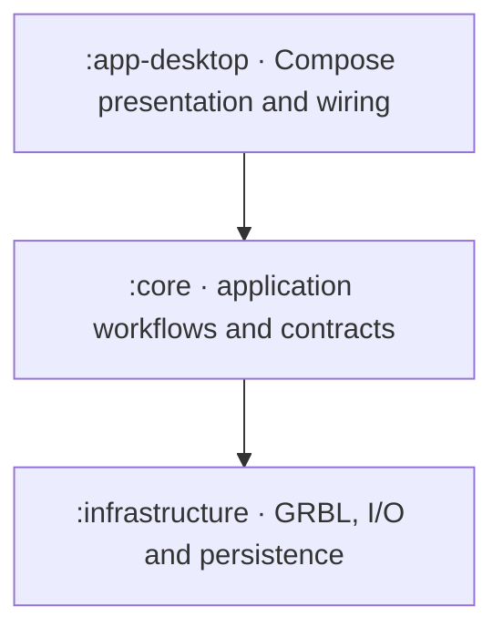
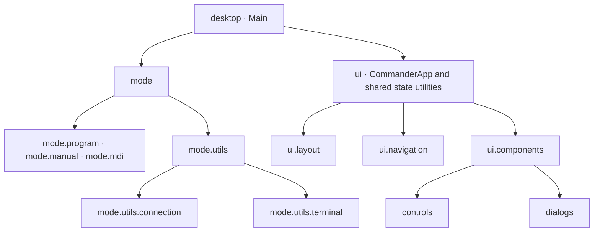

# GRBL Commander architecture

GRBL Commander is a Kotlin/JVM desktop operator interface for GRBL-compatible
CNC machines, with grblHAL as the primary target. The Compose shell is designed
for touchscreen use and supports mouse and keyboard input. The application
presents controller observations, takes operator input and coordinates
communication. The controller owns motion planning, real-time execution,
machine I/O and controller-side macros.

## Modules and dependencies

Three Gradle modules run in one desktop process. Compile-time dependencies
follow the arrows below.

| Module | Owns |
| --- | --- |
| `:app-desktop` | `Main` wires startup and shutdown. `CommanderApp` assembles concrete mode roots and shared UI. Screens own interaction, view state and drafts. |
| `:core` | `core.connection` owns the application connection/settings API, endpoint and draft models, validation, settings schema, session factory, polling and shared traffic history. Shared application workflows and domain rules belong here. |
| `:infrastructure` | `machine.session`, `machine.protocol` and `machine.transport` own session synchronization, GRBL framing, TCP/serial I/O and discovery. `configuration` adapts JVM Preferences to opaque record storage. |

Core re-exports the infrastructure API used in its public contracts.
Presentation can read shared values such as `MachineSnapshot` and traffic
events. Screens access workflows through core. Core selects and constructs
the session and transport at its connection boundary. Infrastructure depends
on neither core models nor Compose.

## Desktop package ownership

Package names are relative to `no.grblcommander.desktop`. Edges show the
package hierarchy.

| When adding | Where it belongs |
| --- | --- |
| An operator mode, screen, or feature-specific dialog | Keep the screen, local state, helpers and fixtures in its owning `mode.*` package. Util's connection and Terminal flows have separate owners. Use a shared mode package only if concrete flows are genuinely shared. Wire mode roots in `CommanderApp`. |
| A reusable visual control | Use `ui.components.controls` or `ui.components.dialogs` for general input or dialog presentation. Accept UI state, data and callbacks. Keep session access, discovery and feature-specific decisions with the caller. Shared UI infrastructure stays independent of `mode.*`. |
| A stack, softkey or layout contract | Keep routing, screen lifecycles, typed results and softkey binding in `ui.navigation`. Keep shell regions, tiles and workspace sizing in `ui.layout`. |
| A state owner | Keep interaction and editing state in the screen. Move shared application state, workflows, validation and persistence policy into core. Obtain live machine facts from the session through the shared connection. |
| A protocol, storage or platform adapter | Put GRBL semantics, technical state, device I/O and storage adapters in infrastructure. Isolate native desktop concerns such as windowing and packaging at their integration boundary. Keep core portable and independent of Compose, native APIs and transport-specific libraries. |
| A package or Gradle module | Extend the existing owner when responsibilities are cohesive. Create a package for a distinct, implemented responsibility. Add a Gradle module only for a concrete benefit such as dependency isolation, separate reuse or independent testing. |

Name screens by their operator-facing role, for example `Editor`,
`FileExplorer`, `ManualMode` or `Terminal`. Use a `Screen` suffix only to
distinguish a same-named model or service. Give each primary top-level type a
same-named file. A small supporting result or helper may share its owner's file
when it forms part of the same contract and has no independent use.

## Design constraints

- **One communication path.** Coordinate all writes through the shared session.
  Realtime commands must stay responsive independently of ordinary line
  acknowledgments. UI-mode changes preserve drafts and navigation without
  affecting controller execution.
- **The controller is authoritative.** Check confirmed state before an
  operation. Treat loss of communication as unknown machine state and show
  stale values explicitly. An acknowledgment confirms acceptance or rejection.
  Determine physical completion from controller observations.
- **Machine safety.** Prevent conflicting motion or program operations.
  Require explicit confirmation where appropriate. Distinguish warnings,
  alarms, holds and emergency-stop conditions. Reconnect must never replay
  uncertain commands or resume interrupted motion. Physical emergency-stop
  circuits and machine-level interlocks operate independently.
- **Separate analysis, visualization and execution.** Report unresolved G-code
  and uncertain progress. A preview cannot prove safe execution. Preserve
  program and macro source and use controller-defined macro interfaces.
  Discover or explicitly configure optional firmware capabilities.
- **Linux and Windows share the JVM codebase.** Prioritize Linux touchscreen,
  serial/USB and kiosk operation, including scaling, X11/Wayland and device
  permissions. Isolate platform integrations and document Windows alternatives
  or limitations. Optional native integrations should degrade gracefully. JVM
  modules are shared across platforms. Introduce platform-specific source sets
  only when concrete behavior requires them. macOS is outside the supported
  release matrix.
- **Test without physical hardware where possible.** Validate machine-independent
  behavior with recorded traffic, simulations and deterministic UI fixtures.
  Verify shared behavior on Linux and Windows and validate physical motion
  behavior on appropriate controller hardware before making safety claims.

## System guides

| Guide | Scope |
| --- | --- |
| [Desktop UI layout](ui-layout.md) | Persistent shell, operator modes and supported interaction model |
| [Screen navigation](screen-stack.md) · [Dialogs](dialogs.md) | Retained stacks, input isolation, typed results and modal/choice primitives |
| [Workspace sizing and softkeys](layout-grid-unit.md) · [Touch keypads](keypads.md) | Grid sizing, binding and activation, keymaps and editing |
| [Controller connection and settings](controller-connection.md) | Core lifecycle, startup, persistence, polling, admission and the Util form |
| [GRBL session](grbl-session.md) · [grblHAL alarms](grbl-alarms.md) | Transports, protocol, correlation, recovery and firmware alarm details |
| [Terminal and traffic diagnostics](terminal.md) | Operator console, command recall and bounded passive observation |
| [Planned machine operations](machine-operations.md) · [Planned programs, macros and tools](programs-macros-tools.md) | Future coordination, jogging/DRO, execution, analysis, controller macros and tools |
| [Building and testing](testing.md) · [UI screenshots](ui-screenshots.md) · [Release process](releases.md) | Verification commands and coverage, visual review and native packaging |
