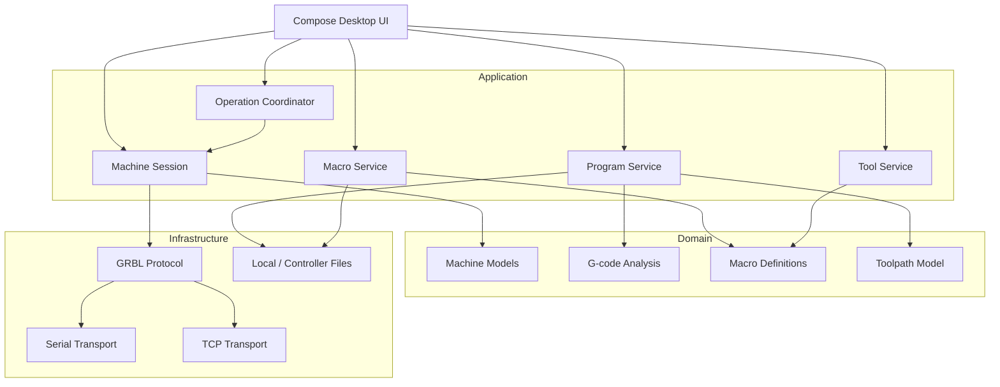

# GRBL Commander — Architecture

## 1. Overview

GRBL Commander is a cross-platform desktop application for operating CNC machines controlled by GRBL-compatible firmware, with particular emphasis on grblHAL and its extensions.

The application provides a touchscreen-oriented operator interface inspired by conventional industrial CNC controllers such as FANUC, Haas, Heidenhain, and Siemens.

GRBL Commander is responsible for presenting machine state, interacting with the operator, managing programs and macros, and coordinating communication with the CNC controller.

**The CNC controller remains responsible for motion planning, real-time motion execution, machine I/O, and controller-side macro execution.**

The architecture prioritizes:

- Reliable and predictable machine control.
- Clear separation of responsibilities.
- Touchscreen operation with consistent controls.
- Support for grblHAL extensions without depending on a particular firmware configuration.
- Reuse of functionality across operating modes.
- Extensibility without introducing unnecessary abstraction.
- Testability without requiring physical CNC hardware.

GRBL Commander supports Linux and Windows as its verified desktop targets. Linux is the primary development, integration, and deployment focus, particularly for dedicated touchscreen CNC computers. Cross-platform compatibility across these supported targets is an architectural requirement. macOS is not tested or distributed as an officially supported platform.

## 2. Architectural Style

GRBL Commander uses a **modular monolithic architecture**, with explicit boundaries between UI, application logic, machine communication, and G-code processing.

A single desktop process is sufficient for the initial implementation. Components should be separated through packages and interfaces rather than independently deployed services.

The primary architectural layers are:

1. **Presentation** — Operator interface and UI state.
2. **Application** — Use cases, workflows, and operation coordination.
3. **Domain** — Machine-independent models and rules.
4. **Infrastructure** — GRBL protocol, transports, file storage, and external integrations.

Dependencies should point inward toward domain abstractions. UI components must not communicate directly with serial ports or construct protocol-specific command sequences.

### Component overview



The diagram illustrates responsibilities and dependencies, not necessarily separate Gradle modules or runtime processes.

## 3. Machine Communication

### 3.1 Transport

Communication with the CNC controller is abstracted behind a transport interface.

Initial implementations:

- Serial/USB transport.
- TCP transport where supported.

A transport handles establishing a connection, reading and writing bytes, connection lifecycle, and transport errors.

It has no knowledge of G-code semantics, controller state, or UI modes.

### 3.2 GRBL Protocol

A protocol implementation translates between controller-specific messages and application-level operations.

Responsibilities include:

- Parsing status reports, acknowledgments, errors, alarms, and controller messages.
- Sending ordinary commands and real-time commands.
- Correlating responses with queued requests where the protocol permits.
- Managing command transmission and flow control.
- Retrieving settings, coordinate offsets, modal state, and other information.
- Discovering controller capabilities and supported extensions.

**All protocol writes must pass through a single coordinated communication component.**

Normal G-code commands, program streaming, status polling, and real-time commands have different transmission requirements. Real-time commands must not be blocked behind ordinary queued G-code.

The implementation must distinguish command acknowledgment from completion of the corresponding machine operation.

### 3.3 Controller Compatibility

The primary implementation targets grblHAL.

Support for other GRBL-compatible firmware should be possible through capability detection and protocol-specific behavior, without weakening grblHAL functionality.

Capabilities may include:

- Supported axes and coordinate systems.
- Tool tables.
- G65 macros and expression support.
- Controller-hosted files and SD storage.
- Tool change protocols.
- Probing and tool setters.
- Additional status report fields.
- Controller-specific commands and extensions.

A feature must not be presented as available merely because it exists in upstream grblHAL. Availability depends on the connected controller, firmware build, driver, and enabled plugins.

### 3.4 Machine State

The application maintains an observable representation of the latest confirmed controller state.

This includes:

- Controller execution state (`Idle`, `Run`, `Hold`, `Jog`, `Alarm`, etc.).
- Machine and work positions.
- Active work coordinate system and offsets.
- Feed and spindle state and overrides.
- Active and selected tools.
- Homing and probe input state.
- Connection health and freshness of reported data.
- Available controller capabilities.

Machine state is exposed as immutable snapshots through Kotlin `StateFlow`.

The controller is authoritative. Locally predicted positions or operation outcomes must never silently replace confirmed controller observations.

Disconnected or stale values must be visibly distinguished from live values.

## 4. Application Operations

Application operations represent user intentions rather than raw protocol commands.

Examples:

- Home machine.
- Jog an axis.
- Set a work coordinate.
- Execute an MDI buffer.
- Start or resume a program.
- Run a macro.
- Read controller settings.
- Synchronize macros.

The **Operation Coordinator** is responsible for:

- Validating operation preconditions.
- Preventing conflicting operations.
- Managing operation ownership and lifecycle.
- Dispatching commands through the machine session.
- Monitoring controller state.
- Reporting progress, completion, failure, and interruption.

Only one operation that owns machine motion or program execution may be active at a time. Monitoring and permitted real-time controls remain available independently.

An operation must not be considered complete solely because its final G-code block received an `ok` response.

Program streaming, controller-hosted execution, and macro execution may require different completion and progress strategies.

### 4.1 Global Controls

Cycle Start, Feed Hold, Reset, and overrides are application-wide operations.

Their behavior depends on the active operation and actual controller state, not solely on the currently displayed UI mode.

For example, Cycle Start may start a prepared MDI buffer, start a selected program, or resume an operation held by the controller.

The UI must clearly distinguish starting a new operation from resuming an existing one.

### 4.2 Jogging

Jogging uses the controller's dedicated jogging protocol when available.

Both incremental and continuous jogging are supported.

Continuous jogging must account for touch release, cancellation, application focus loss, connection interruption, and delayed input events. Its safety must not depend exclusively on receiving a touch-release event.

### 4.3 Operator Interaction

Controller messages and state transitions may require operator intervention, particularly during tool changes and macros.

The application provides a centralized operator-interaction system for:

- Informational messages.
- Warnings and alarms.
- Program pauses.
- Tool change instructions.
- Actions requiring explicit operator confirmation.

Messages are not automatically interpreted as blocking requests. Resumption and acknowledgment must follow the controller's actual protocol and state.

## 5. User Interface

The user interface is implemented with **Compose Multiplatform Desktop**.

It is designed primarily for touchscreen use while retaining keyboard and mouse support.

### 5.1 Persistent Layout

The main screen consists of:

- **Mode Header:** Active application mode and controller status.
- **DRO:** Machine position and active work coordinate position.
- **Workspace:** Content specific to the selected mode.
- **Right Softkeys:** Persistent global controls and contextual actions.
- **Bottom Softkeys:** Context-dependent actions.

Softkeys use shared components and a common action model. Their labels, enabled states, and actions are determined by the active mode, dialog, and machine state.

Global functions retain consistent positions across modes.

**Current implementation:** The desktop shell renders a header with Program, Manual and MDI UI-mode selection, a central workspace, eight bottom softkey slots and seven right softkey slots. Each window retains a `ScreenStack` for each UI mode, hosted together by `ScreenStackHost`. Program includes the branded welcome screen and a runnable in-memory editor/file-explorer example. Manual has a nested details screen with local notes; MDI has an unsent text buffer. Mode changes do not cancel overlays, discard drafts, or alter controller execution state. The window icon and header show the supplied app logo. Softkey slots are noninteractive visual placeholders; controller communication, DRO, real mode operations and machine status reporting are not implemented. The header explicitly displays an unconnected state. The shared slot layout is described in [UI layout](ui-layout.md).

### Screen navigation contract

Presentation defines `NavigationParent`, `Screen<R>`, `ScreenStack` and
`ScreenStackHost` in the desktop `ui.navigation` package. Both `Screen<R>`
and `ScreenStack` implement `NavigationParent`; `screenStack` returns the
owning stack. A root screen is bound by `ScreenStack(root)` after construction,
so the root never needs its stack while being initialized. Other screens are
bound by the stack when opened or pushed, and unbound on removal.

A screen owns its UI in `Content()`, its state, a typed cancellation value,
and `open(parent, onResult)` / protected `finish(result)` methods. A plain
screen uses `Screen<Unit>(Unit)` without a dedicated result class. The
`FileExplorer` screen uses `FileExplorerResult.Selected(filename)` and
`Cancelled`. `ScreenStack` owns instance identity, observable stack changes,
binding, root protection, guarded completion and at-most-once callback delivery.
Ordinary `pop()` and `dismiss()` deliver the screen's cancellation result;
completion and cancellation restore the underlying screen before the callback
runs. A covered screen cannot open or finish another screen. Opening with the
stack itself as parent is an explicit direct navigation action that adds above
the current top, even when overlays are present. Independent stacks never share
navigation bindings or a global navigator.

`ScreenStackHost` accepts a single `ScreenStack` or several stacks with one
designated active stack. Each hosted stack retains its root-to-top screen
compositions, including covered overlays. In multi-stack hosting it draws only
the active stack and restricts pointer, keyboard, focus traversal and
accessibility interactions to that stack's top screen. An inactive stack
cannot request focus; activation clears stale focus and focuses the current
top screen. Switching the active stack does not alter any navigation entries
or pending typed callbacks. Every screen retains ordinary Compose `remember`
state, not merely screen-instance fields. `CommanderApp` creates the stacks
once per application window and keeps the active UI-mode selection in Compose
state; there is no mode-specific navigation registry or globally shared host.

Header and softkey regions remain owned by `AppShell` outside workspace input
boundaries. Navigation is observable through Compose snapshot state and confined
to the UI thread; it does not create transports or modify controller execution
state. Visual overlay layout and input isolation are independent of softkey
inheritance. Screens own stable typed bottom/right maps of immutable `SoftKeyDefinition`
or `SoftKeyModifier` overrides in `ui.softkeys`. Definitions carry bound instance
callbacks and reactive enabled/active predicates; `Blank` is empty and
non-actionable. Modifiers transform definitions without a central action registry.
Shell rendering/activation integration is in progress. Cross-screen softkey
inheritance and modifier composition remain planned in issue #4.
The current mode examples are local UI fixtures; real program/file services
and machine operations are not implemented. Detailed lifetime, root, rendering
and focus behavior are specified in [UI layout](ui-layout.md).

### 5.2 Application Modes

Initial modes:

| Mode | Responsibilities |
|---|---|
| Manual/Jog | Jogging, homing, positioning, coordinate setup |
| MDI | G-code input, editing, and execution of a temporary program buffer |
| Program | Program selection, editing, toolpath preview, and execution |
| Probing | Macro-driven probing workflows |
| Macros | Macro discovery, editing, execution, and synchronization |
| Debug | Communication terminal, diagnostics, and controller inspection |

Tool Management may be presented as a mode or as a workspace accessible from Program and Macros.

**Application modes are UI contexts, not controller execution states.**

Switching UI mode must not implicitly modify machine state or interrupt an active operation. Each window retains its mode stacks and their composed navigation histories independently. The current demonstration provides Program, Manual and MDI contexts; probing, macro and debug workspaces remain planned.

### 5.3 DRO

The DRO remains visible in most operating contexts.

It displays the position of every available axis in both machine coordinates and the active work coordinate system.

Where permitted, coordinates can be edited through context-sensitive actions, including:

- Set to zero.
- Set to a specified value.
- Halve the displayed coordinate value.
- Apply a relative adjustment.

Editing a work coordinate changes the appropriate coordinate offset. It must not implicitly request machine movement.

Machine coordinates are read-only during normal operation.

### 5.4 Shared UI Components

Reusable components include:

- G-code editor.
- Touch-optimized G-code keyboard.
- Numeric input and unit-aware controls.
- DRO and coordinate editor.
- Macro parameter dialogs.
- Tool table and tool inventory views.
- Program block navigation.
- Toolpath viewer.
- Confirmation and operator-intervention dialogs.
- Communication terminal.

Views consume application state and dispatch typed operations. They do not own machine communication.

## 6. Programs and G-code

### 6.1 Program Model

A CNC program is a first-class application object.

It contains the original source, ordered blocks, optional file identity, editing state, and analysis results.

Programs may originate from:

- Local files.
- Temporary MDI buffers.
- Controller-hosted storage.
- Generated or imported content.

MDI and Program modes share the same underlying program model and execution infrastructure.

### 6.2 G-code Analysis

G-code parsing and analysis are separate from execution.

The analyzer provides:

- Syntax and structural analysis.
- Identification of commands, words, expressions, and macros.
- Modal state tracking.
- Block-to-toolpath associations.
- Static extraction of tool requirements and macro invocations.
- Diagnostics for unsupported or unresolved constructs.

The parser must accommodate grblHAL-specific features, including expressions, variables, flow-control constructs, and extensions where supported.

**Static analysis is not a substitute for controller-side G-code execution.**

Dynamic expressions, controller variables, macro calls, and conditional execution may prevent complete static interpretation. The analyzer must represent uncertainty explicitly instead of producing an apparently complete but incorrect result.

### 6.3 Toolpath Visualization

Toolpath generation is independent of the UI renderer.

The analysis layer produces geometry and metadata associated with source blocks.

The initial renderer uses Compose Canvas/Skia for 2D and 2.5D visualization, including axis projections, zoom, pan, rapid/feed distinction, and selected-block highlighting.

Hardware-accelerated 3D visualization and material removal simulation may be introduced later behind the same geometry model.

Rendering must distinguish resolved geometry from paths that cannot be evaluated reliably.

### 6.4 Program Execution

Program execution supports multiple execution strategies:

- Host-streamed G-code.
- Controller-hosted file execution, when supported.
- Single macro invocation.

Each strategy exposes a consistent application-level lifecycle while retaining its protocol-specific behavior.

Execution progress must distinguish source position, submitted blocks, acknowledged blocks, and reported controller execution position where available.

## 7. Macro System

Macros are first-class programs executed by the controller whenever the controller supports the required functionality.

GRBL Commander does not implement a competing interpreter for controller-side macro logic.

The Macro Service handles:

- Macro discovery and cataloging.
- Source editing.
- Macro metadata and parameters.
- Invocation construction.
- Local/controller version comparison.
- Synchronization and backup.
- Associations with application functions and UI categories.

### 7.1 Macro Definitions

Macro interfaces are determined by the macro implementation and the controller's supported argument-passing conventions.

For example, a `G65 P200` invocation follows the interface expected by `P200.macro`, regardless of whether the caller is a Fusion postprocessor, another macro, or the user interface.

Optional metadata describes how a macro should be presented:

- Display name and description.
- Category.
- Parameter names, types, units, defaults, and constraints.
- Available operator actions.
- Supported machine configurations.

Metadata may be stored in sidecar files or derived partially from source comments and static analysis.

The source macro remains executable without GRBL Commander or its metadata.

### 7.2 Macro-Driven Workflows

Probing and tool-related functions are primarily composed from controller macros.

A generic macro parameter UI can generate operator dialogs without hardcoding individual probing operations.

Complex workflows, including tool changes and tool-length probing, remain controller-owned when implemented by controller-side macros.

Host-coordinated workflows may be supported for operations requiring application-side interaction, but must explicitly define failure and interruption behavior.

### 7.3 Macro Synchronization

Macros may exist in:

- A configured local directory.
- Controller storage.
- An external version-controlled repository.

The synchronization service compares versions, identifies conflicts, and allows the operator to choose which changes to apply.

Critical macros must not be replaced during execution.

Synchronization should support backups, transfer verification, and explicit operator approval before overwriting controller files.

## 8. Tool Management

Tool management distinguishes three concepts:

**Program Tool Requirements** describe which tools a particular CNC program requires.

**Machine Tool Inventory** describes which tools the machine has registered, their locations, and any available descriptions.

**Tool Geometry and Compensation** describe measured offsets and geometry used by the controller.

These are related but are not interchangeable.

### 8.1 Program-Declared Tools

Programs may declare their required tools through macro invocations.

The application can analyze these declarations, resolve them against known macro definitions, and display a Program Setup view before execution.

The application must not assume that analyzing a declaration means the controller has registered the corresponding tool.

### 8.2 Controller Tool Data

The application should support grblHAL tool tables when available, including their supported offsets, names, and pocket assignments.

It should also support macro-managed tool inventories, as used by custom tool-management macros.

The domain model should not require a specific tool-table implementation.

Controller-reported data is authoritative for the state and compensation actually used by the controller. Optional local metadata may enrich the presentation.

The application must avoid creating competing, silently synchronized sources of truth for rack assignments or tool offsets.

## 9. Safety and Failure Handling

GRBL Commander is an operator interface, not a safety controller.

Physical emergency-stop circuits and machine-level safety mechanisms remain independent of the application.

The application must:

- Prevent conflicting motion and execution requests.
- Validate machine-state preconditions before issuing operations.
- Treat communication loss as an unknown machine state.
- Prevent blind replay of unacknowledged motion commands after reconnection.
- Preserve real-time control responsiveness.
- Require explicit confirmation for potentially hazardous actions where appropriate.
- Distinguish warnings, alarms, holds, and emergency-stop conditions.
- Never automatically resume interrupted motion following reconnection.
- Avoid presenting simulated or predicted outcomes as confirmed machine state.

Raw command access remains possible in Debug mode, but bypassing application-level workflows must be explicit.

Software validation and toolpath previews cannot guarantee collision-free or safe machine execution.

## 10. Platform Strategy

GRBL Commander is a **cross-platform desktop application** supporting Linux and Windows from a shared codebase. Linux is the priority for CNC-machine integration, deployment, testing, and operator experience. Windows is a supported target; macOS is not part of the verified platform matrix.

### 10.1 Shared Runtime and Codebase

The application uses Kotlin/JVM and Compose Multiplatform Desktop on all supported desktop operating systems.

Kotlin Multiplatform source sets are not required merely to run the same JVM application on multiple operating systems. They may be introduced if a concrete need for platform-specific code justifies them.

Core application functionality must remain platform-independent, including:

- Machine state, command coordination, and execution workflows.
- GRBL protocol parsing and G-code processing.
- Programs, macros, and tool management.
- Toolpath geometry and visualization.
- UI modes, interaction behavior, and application state.

Portable domain and application code must not depend on operating-system-specific APIs.

### 10.2 Platform Adapters

Platform-specific behavior belongs behind infrastructure interfaces or dedicated adapters, as needed.

Examples include:

- Serial-port discovery, USB device identification, and permissions.
- Native file dialogs, filesystem locations, and user configuration paths.
- Touch input and on-screen keyboard integration.
- Window management, display scaling, and fullscreen or kiosk behavior.
- Application packaging, installation, and startup integration.

Shared functionality should behave consistently across platforms. An OS-specific integration must not become a requirement for unrelated features, and unavailable optional integrations should degrade gracefully.

### 10.3 Linux-First Optimization

Linux receives particular attention for:

- Stable USB/serial device paths and permissions, including udev-based configuration where applicable.
- Reliable operation on dedicated CNC computers.
- Touchscreen ergonomics and optional on-screen keyboard integration.
- X11 and Wayland behavior.
- High-DPI scaling and different display sizes.
- Fullscreen and kiosk-style operation.
- Native Linux packaging and startup integration.

Linux-specific improvements must remain isolated from shared machine-control and UI logic whenever possible.

### 10.4 Windows and Unverified Platforms

Windows uses the same application codebase and feature model as Linux. Differences in serial-port discovery, permissions, native UI behavior, and packaging are handled by platform integrations. macOS is not a verified, packaged, or officially supported target, although the shared Kotlin/JVM and Compose implementation may run there.

Features should not be marked as generally supported until their relevant behavior has been verified on Linux and Windows. Linux-specific capabilities must have an explicit Windows alternative or a clearly documented limitation.

### 10.5 Build, Testing, and Distribution

Continuous integration runs shared tests and platform-relevant smoke tests on Linux and Windows runners. Desktop packaging produces native distribution artifacts for these supported operating systems; macOS runners and DMG packaging are not required.

Linux is the primary environment for physical CNC-machine integration testing. Automated cross-platform tests do not replace verification with actual controller hardware.

Cross-platform compatibility is part of the definition of done for changes affecting shared behavior. Platform-specific exceptions must be intentional and documented.

Native release packaging is driven by GitHub Actions after a pull request is merged into `main`. Git tags determine published versions, and Gradle receives the resolved version for every platform package. Linux releases include DEB and RPM packages and Windows releases include MSI. Packaging runs on native CI hosts; releases are only published once all required Linux and Windows artifacts have been built. Version selection and operator-facing distribution limitations are described in [releases.md](releases.md).

## 11. Technology

Initial technology choices:

| Concern | Technology |
|---|---|
| Language | Kotlin/JVM |
| UI | Compose Multiplatform Desktop |
| Concurrency | Kotlin Coroutines |
| Observable state | StateFlow |
| Serial transport | jSerialComm |
| 2D rendering | Compose Canvas / Skia |
| Build | Gradle Kotlin DSL |
| Configuration | Kotlin serialization with an appropriate persistent format |
| Testing | Kotlin/JVM tests, simulated controller, and cross-platform CI |
| Packaging | Platform-native desktop distributions |

Infrastructure libraries should remain replaceable behind interfaces where replacement is reasonably likely.

The domain and application layers should avoid direct dependencies on Compose, transport-specific libraries, or operating-system-specific APIs.

## 12. Source Organization

The current Gradle build contains an `app-desktop` module for the Compose desktop shell. The `core` and `infrastructure` modules in the example below describe the intended organization and are not implemented.


Start with a small number of Gradle modules. Use packages to establish component boundaries. The same JVM modules are shared by Linux and Windows; platform-specific integrations can remain isolated within infrastructure.

Suggested initial structure:

```text
grbl-commander/
├── app-desktop/
│   └── src/main/kotlin/
│       └── .../
│           ├── ui/
│           │   ├── layout/
│           │   ├── components/
│           │   └── modes/
│           └── bootstrap/
│
├── core/
│   └── src/main/kotlin/
│       └── .../
│           ├── machine/
│           ├── operations/
│           ├── program/
│           ├── gcode/
│           ├── macros/
│           ├── tools/
│           └── toolpath/
│
├── infrastructure/
│   └── src/main/kotlin/
│       └── .../
│           ├── grbl/
│           ├── transport/
│           ├── storage/
│           └── configuration/
│
├── docs/
│   └── architecture.md
│
└── settings.gradle.kts
```

Additional Gradle modules should be introduced when there is a concrete benefit, such as independent testing, dependency isolation, or separate reuse.

The package layout is illustrative, not a requirement to create every package immediately.

## 13. Testing

Machine-control functionality must be testable without physical hardware.

The test strategy includes:

- Protocol parser tests using recorded controller messages.
- Simulated controller tests for command acknowledgment and state transitions.
- Program streaming tests covering flow control, interruption, and failure.
- Operation coordinator tests for conflicting requests and cancellation.
- G-code analysis tests with representative programs and macros.
- UI tests using deterministic machine-state snapshots.
- Integration tests with supported physical controller configurations.
- Cross-platform CI on Linux and Windows for shared functionality and relevant desktop integrations.
- Platform-native packaging smoke tests.

The simulated controller should support configurable delays, missing responses, errors, alarms, disconnections, and tool-change pauses.

Existing grblHAL macro repositories can serve as regression fixtures for macro parsing, invocation analysis, and program setup.

Physical machine testing remains necessary before relying on motion-related functionality.

## 14. Implementation Priorities

Implementation should proceed incrementally while maintaining the architectural boundaries.

### Phase 1 — Machine connection and manual operation

- Desktop application shell and mode navigation.
- Serial connection and GRBL protocol.
- Machine-state monitoring and DRO.
- Global controls, overrides, homing, and jogging.
- Debugging terminal.
- Simulated controller tests.

### Phase 2 — Program handling

- Local program loading and editing.
- MDI buffer and G-code keyboard.
- Host-side program streaming.
- Program execution lifecycle.
- Initial toolpath visualization.

### Phase 3 — Macros and tool management

- Macro catalog and editor.
- Controller file access.
- Macro metadata and parameter dialogs.
- Macro synchronization.
- Program tool requirements and setup.
- Tool inventory and controller tool-table integration.
- Macro-driven probing UI.

### Phase 4 — Extended functionality

- Advanced toolpath visualization.
- Additional probing workflows.
- Controller-hosted program execution.
- More comprehensive machine configuration.
- Expanded protocol and transport compatibility.
- Optional host-coordinated workflows.

These phases describe implementation priorities rather than hard boundaries. Shared components should be introduced when required by real functionality.

## 15. Design Principles

The following rules guide architectural decisions:

1. **The controller is authoritative.** Do not duplicate controller-owned machine behavior unnecessarily.
2. **One communication owner.** All commands to a controller pass through a coordinated machine session.
3. **Separate analysis from execution.** G-code inspection and visualization must not implicitly execute commands.
4. **Macros define their interfaces.** Application functionality should build on macro contracts rather than hardcoded assumptions about individual macro numbers.
5. **Modes share infrastructure.** UI navigation must not create independent machine-control implementations.
6. **Support capabilities, not assumptions.** Optional firmware functionality must be discovered or explicitly configured.
7. **Preserve the original source.** Programs and macros remain valid independently of the application.
8. **Make uncertainty visible.** Unknown machine state, unresolved G-code, and incomplete operation status must be represented explicitly.
9. **Prefer simple boundaries.** Add abstraction where it protects meaningful responsibilities, not merely to anticipate hypothetical extensions.
10. **Keep the architecture testable.** Machine-independent behavior should be verifiable without connecting to physical hardware.
11. **Cross-platform by design.** Shared functionality must work on Linux and Windows; prioritize Linux integration without coupling core features to Linux-specific APIs.

## 16. References

- [grblHAL core](https://github.com/grblHAL/core)
- [grblHAL documentation](https://www.grblhal.org/)
- [grblHAL SD card and macro plugin](https://github.com/grblHAL/Plugin_SD_card)
- [Existing grblHAL macro examples](https://github.com/skasti/grblhal-macros)
- [Compose Multiplatform](https://www.jetbrains.com/compose-multiplatform/)
- [jSerialComm](https://github.com/Fazecast/jSerialComm)
