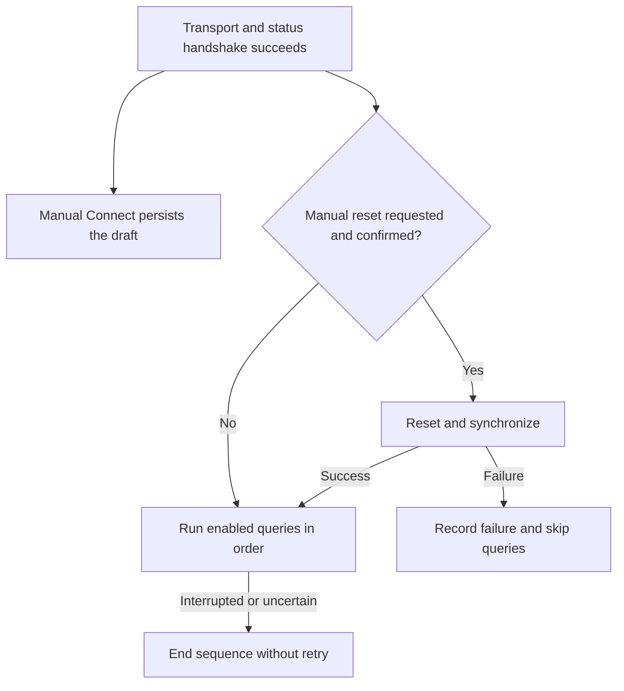
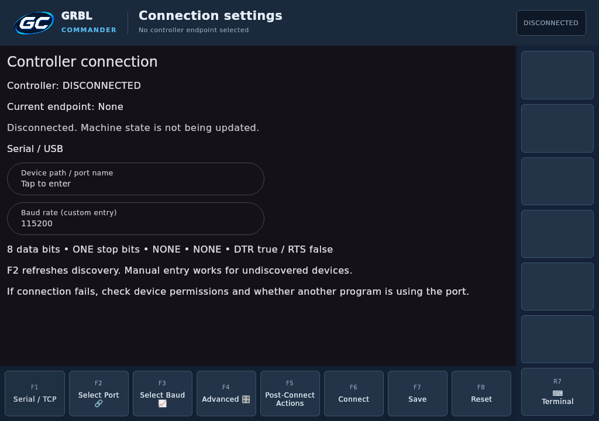

# Controller connection and settings

Core owns the application connection and saved settings.
[The GRBL session](grbl-session.md) owns protocol synchronization and physical I/O.
The [Terminal](terminal.md) submits manual commands through this same owner.

## Application connection ownership

`core.connection.ControllerConnection` is the UI-independent application
boundary in `:core`. `Main` in `:app-desktop` creates one connection owner and
one `ControllerSettings` instance above the window/mode stacks, passes them into
presentation, and owns [application shutdown](#settings-startup-and-shutdown).
`CommanderApp` supplies the same connection owner to every retained mode
through `LocalControllerConnection`. The same owner coordinates
[controller storage requests](controller-storage.md#application-api).

`ControllerEndpoint.Tcp(host, port)` and `ControllerEndpoint.Serial(configuration)`
select `TcpTransport` and `SerialTransport` through a small factory. Serial uses
`SerialConfiguration` unchanged, including its 115200/8N1/no-flow-control
defaults (DTR on, RTS off). Native serial-port lookup occurs at connect rather than endpoint
selection. `ControllerEndpointDraft` validates editable fields without DNS lookup
or I/O. TCP uses an explicitly entered port (1–65535). Serial permits manual Windows port names and Linux device paths, including
devices absent from discovery.

## Settings, startup and shutdown

`ControllerSettings` in core owns the observable saved `configuration`, separate
from the active session endpoint and a screen's unsaved draft. Its load/save
workflows serialize configuration access, validate loaded/edited values and
publish configuration after a successful read/write. Loading occurs through the
core operation at application startup and when the form opens. Main launches `initialize()` and cancels/joins its
application scope at shutdown. The desktop entry point uses
`application(exitProcessOnExit = false)`: window close returns through Main's
`finally` block instead of terminating the JVM before cleanup. Main cancels the
application scope, calls `connection.close()`, awaits `connection.awaitClosed()`
and joins the application job. This disposes TCP/serial resources, stops polling
and cancels pending handshake/command work before normal process completion.
No machine reset, hold or unlock is sent
as part of exit. `CommanderApp` signals `onUiReady()` after composition.
Core initialization loads configuration and asynchronously attempts a valid saved
endpoint at most once. Missing/invalid data skips connection. Manual actions cancel
pending initialization. Direct connection lifecycle intentions also prevent delayed
automatic replacement. Automatic/manual attempts share the connection lifecycle lock.
Startup never retries, unlocks or navigates automatically. See the
[post-connect policy](#post-connect-policy-and-connection-drafts) for startup queries. Startup failure updates
core connection state and the header only. Settings can inspect its details.
Presentation delegates explicit requests to the [settings actions](#explicit-connection-actions).

`ControllerEndpointRecord` in core maps typed endpoints to/from the versioned
Properties text. Missing, incomplete, invalid or unsupported records leave the
endpoint unselected and retain normal serial defaults. Infrastructure's
`configuration.ControllerEndpointPreferences` reads/writes that opaque text using
JVM per-user preferences, at node `no/grblcommander/controller`, key `endpoint`.
The v2 record retains v1 endpoint fields and adds post-connect choices and the complete
saved form, including unselected transport fields. Valid v1 records remain readable
with explicit DTR/RTS preserved. Missing post-connect fields use normal defaults
only for v1. Incomplete/invalid v2 records restore defaults. The endpoint field names and representation are stable. Storage does not interpret or
validate endpoint models. This small string boundary keeps infrastructure
independent of core without duplicating models or introducing a repository
framework. Storage/flush failures propagate through core. Core dispatches storage
I/O.

`SerialPortDiscovery` in `:infrastructure` enumerates jSerialComm ports on the I/O
dispatcher, returning device paths/names and descriptive labels without opening
ports or changing control lines. Empty discovery and native/permission failures
are distinct results. Cancellation propagates. Discovery is advisory, so manual
device entry remains valid independently of its result. Presentation requests
discovery through `ControllerSettings.discoverSerialPorts()`. The native adapter
and enumeration remain in infrastructure.

## Explicit connection actions

`ControllerSettings` validates and orchestrates explicit load/save/connect/disconnect
requests through the existing owner. Replacing or disconnecting a connected or
connecting session requires explicit interruption confirmation. Save only
persists configuration. It neither opens nor reconfigures a session. Connect saves only after successful handshake.
A subsequent storage failure leaves connected health visible. Cancellation during
handshake closes the unfinished attempt. Disconnect remains available during it.
The settings screen tracks its one active job as Save, Connect or Disconnect.
The application reports handshake completion before persistence begins, so this
phase does not depend on later connection-health changes. Disconnect can replace
only Connect, awaiting cancellation/cleanup of an unfinished
handshake, or awaiting its settings save if handshake has completed. Save and a
running Disconnect cannot be cancelled by another Disconnect action. Workspace
buttons and softkeys share the same enabled predicate, and callbacks also guard
against repeated activation.

## Manual command admission

`ControllerConnection.executeLine` validates with the existing protocol encoder
and reserves a single manual command slot before dispatch through the session's
command buffer. Admission requires an
open, connected session with a fresh, synchronized `Idle`, `Alarm` or
`Check` report. A reset boundary, pending manual command or post-connect
work blocks admission. The session applies the final protocol and alarm checks.
This prevents normal terminal commands during externally running work. The slot
ends on acknowledgment or failure, never represents completed physical motion and
is not transferred across sessions. `sendRealtime(CYCLE_START)` independently
rechecks a fresh synchronized `Idle` or `Hold:0` report, with no alarm, closing
connection, post-connect work or reset boundary. The same predicate drives
the Terminal softkey.
Acknowledgment is not motion completion: explicit Cycle Start can resume a
completed Feed Hold even after the line's acknowledgment or for externally initiated
work. It sends one realtime `~`, without resubmitting a command or predicting
execution state. Run, Hold:1 (deceleration), Jog, Door, Alarm, missing/unrecognized
status and stale/disconnected reports are rejected. No diagnostic handoff or
pending-line ownership is required for this operator action. See [planned machine operations](machine-operations.md) for broader coordination. Status, Feed Hold and Reset
remain independent of normal-command admission.

## Freshness and background polling

Both header and form read the same authoritative owner state. A presentation clock
marks retained reports stale after three seconds, even without a new state emission.
Disconnected/unknown reports are not live.

Each active connection owns one core background polling coroutine, independent
of UI composition and mode selection. After successful handshake it waits 500 ms
and sends `RealtimeCommand.STATUS_QUERY` through the existing session realtime
writer. It does not await a response or hold the explicit `queryStatus()` mutex.
The single session reader handles every report. Normal-command acknowledgment
slots and traffic categorization are unchanged. Polling waits 500 ms after each
write completes, so slow writes cannot overlap or create catch-up bursts.

Polling pauses while `resetInProgress` because reset owns its status handshake.
Alarms, `resetRequired` and uncertain normal-command correlation do not block
status requests. Recoverable write failures/timeouts retain the session's existing
diagnostics and permit the next scheduled poll. Cancellation propagates. Actual
connection failure stops polling, and disconnect/reconfiguration/replacement or
application/parent shutdown cancels and awaits the old connection's polling work.
A reconnect creates one fresh loop only after disposing the old session. No
normal command, reset, reconnect or status-derived success is synthesized.
Missing responses remain visibly stale.

## Session replacement and disposal

The owner starts disconnected. `connect(endpoint)` is an explicit operator
request: it closes, cancels and awaits any old session/handshake before creating
a fresh one-shot session. `disconnect()` can interrupt a pending connection.
`reconfigure(endpoint)` disposes the existing connection and selects the endpoint
without opening it. Failed/cancelled handshakes clean up. Another connection
requires an explicit request. Disposal completes under cancellation protection,
including clearing the active reference and publishing disconnected health with
`closing = false` (or closed health during application shutdown). A cancelled
replacement/reconfiguration cannot leave an inactive owner stuck closing. The
selected endpoint remains available for a subsequent explicit action. Core never reconnects, resets, unlocks, homes, replays commands or resumes
operations as an implicit lifecycle action. Each active session has one core
`CommandBuffer` and a replacement starts with an empty buffer. The buffer
dispatches normal lines through `MachineSession.executeLine`. The session owns
serialization, correlation and uncertain results. Realtime requests and status
queries go directly to the session. Pending lines fail on disposal and their
controller outcome must not be assumed known.

The session buffer exposes a read-only `StateFlow<BufferState>` for the current
batch. Line numbers use one-based batch positions. A successful write
publishes `lastSentLineNumber` with a pending reply. A correlated response sets
the reply to OK or an error carrying the controller code. An interruption
while waiting for that response sets the reply to Unknown. A failed write
that may have transferred bytes sets `uncertainWriteLineNumber` and preserves
the last sent line and its reply. A known local rejection leaves the uncertain
position empty. A new batch starts empty.
The buffer processes each response before advancing, even if a state collector
skips intermediate updates. A rejected line stops ordinary batches. Post-connect
metadata queries can continue after a correlated rejection.

The batch owner supplies the mapping from unambiguous transmitted N words to
batch positions. Only a fresh Run or Hold report with a mapped Ln observed after
that line was sent supplies an execution position. Missing or stale reports
clear it. Command acceptance and sampled execution are independent.

`ControllerConnectionState` exposes the selected endpoint, the authoritative
`MachineSnapshot` and a closing flag. Transport health, controller execution
state, command synchronization and report freshness remain separate. A retained
snapshot after disconnect is an observation, not live machine state. Explicit
disconnect/reconfiguration/shutdown clears the application-level failure field.
The session's technical close reason is not a connection error. State observers
do not publish session-close diagnostics while the application owner is closing.
Unexpected failures remain visible until an explicit lifecycle action acknowledges
them. Navigation alone never clears errors. The owner
and session are explicitly disposable. `awaitClosed()` joins owned work.

## Post-connect policy and connection drafts

PostConnectActions belongs to core and is shared by serial/TCP endpoints and
ControllerEndpointDraft. Reset defaults Off, firmware info defaults $I, and $#
parameters/$G parser state default On. The shared ControllerConnection runs them
through the active session's command buffer after its transport/status handshake.
Connect returns after handshake and starts persistence independently of query completion.
Returning to Terminal keeps that established session and its command buffer alive.
Session shutdown cancels and joins the batch, including after unexpected
transport loss. This work is covered by [session disposal](#session-replacement-and-disposal).
An operator reset on an established connection cancels and joins the batch before
transmitting reset. Normal admission remains blocked while reset is pending. A manual reset preference requires
per-attempt confirmation at both settings and connection boundaries. Startup
always suppresses reset. Confirmed reset calls the existing session reset once,
then awaits its banner/status synchronization before queries.

After a successful handshake, the settings save and session-owned work proceed
independently. Startup follows the query path without issuing a reset.

The buffer dispatches queries in firmware info, parameters, then parser state
order, waiting for a correlated response before each next line. The controller
may reject a query in its current state. Post-connect work reserves normal
dispatch and blocks Cycle Start. Status and Feed Hold remain available
independently, and Reset can interrupt the batch.
A correlated `error:n` rejects its own query and allows the sequence to continue.
Timeout, an alarm or another loss of correlation discards the remaining queries.
Even a late response or a fresh status report cannot resume an invalidated
batch. Reset failure skips the batch. A query failure alone does not imply
transport loss. Core exposes bounded per-attempt result messages. Ordinary responses are retained in existing terminal
traffic. No competing metadata/capabilities cache is introduced.

ControllerSettings exposes the complete savedDraft alongside its configured
endpoint. Save and successful Connect persist it through the same versioned record
and configuration lock.

## Traffic aggregation and retention

Core subscribes to [session communication events](grbl-session.md#communication-events)
before connecting so it captures handshake traffic. `traffic` is a
read-only `SharedFlow<ControllerTraffic>` backed by `MutableSharedFlow` with 1,024
extra slots, `DROP_OLDEST` and `tryEmit`. Publication never suspends machine I/O.
Successful `tryEmit` does not imply every subscriber received every event.
A separate 5,000-event deque retains all observed traffic regardless of UI filters.
`diagnosticSnapshot()` copies it consistently only on explicit request. Entries
carry endpoint, session identity, source sequence, timestamp and global cursor.
The cursor advances by source sequence distance across sessions, so a consumer's
cursor gaps count the union of upstream and core-stream loss once. Multicast-wide
drop counters describe other subscribers too and must not be added to these gaps.
Normal diagnostic retention is not loss. Disconnect and awaited shutdown collect
the remaining session replay tail without duplicate session/sequence identities.

## Util navigation

The [desktop header](ui-layout.md#operator-interaction-and-modes) selects
Util. Connection screens stay on its stack.

`CommanderApp` retains one Util stack rooted at `mode.utils.terminal.Terminal`
per window. Terminal is visible on first entry to Util. Its R7 **🔗 Connection** opens
`mode.utils.connection.ControllerConnectionSettings` above it with an explicit
parent. The form replaces this key with R7 **⌨ Terminal**, which
returns to the same root state. These are navigation actions labelled for their
destination, not selected-screen or connection-health indicators. Terminal has no
self-selection key. Switching modes restores an open settings screen. Settings
replaces both banks and never inherits Terminal filters or realtime actions.

## Connection form

Connection settings retain a complete serial/TCP draft separate from the active
endpoint. Selecting a field enables native text editing, selection and paste in
place, with a touch keypad to its right. The field uses the appropriate [touch keypad](keypads.md#connection-field-keymaps).
F7 or keypad Enter applies the field to the draft. F8 cancels the edit. The
form remains visible with the field-edit softkeys until the edit closes.
The form and keypad scroll as needed on constrained viewports.

| Slot | Serial | TCP |
| --- | --- | --- |
| F1 | Toggle to TCP | Toggle to Serial |
| F2 | Select Port 🔗 | Edit Hostname/IP |
| F3 | Select Baud 📈 | Edit Port |
| F4 | Advanced 🎛️ | Unassigned |
| F5 | Post-Connect Actions | Post-Connect Actions |
| F6 | Connect / Disconnect | Connect / Disconnect |
| F7 | Save | Save |
| F8 | Restore saved/default form | Restore saved/default form |

Switching transport retains unsaved field values. The form owns its draft,
validation and error display. F6 reflects the shared lifecycle and can cancel
a pending handshake. The form shows progress, actual endpoint, failures and
stale or unavailable observations. It uses
a [typed interruption confirmation](dialogs.md#basedialog-and-modaldialog).
The form assigns F1 **Disconnect** or **Disconnect and connect** and F8
**Cancel**. F2 and F3 are blank while it is open. Cancellation preserves the
parent form and draft. The parent applies a confirmed result through core.
Closing the form cancels unfinished form work. An established session outlives the screen.

F8 confirms replacing dirty edits with the latest saved complete form, including
the selected transport, both transport fields and post-connect choices. Without
a valid saved record it restores blank endpoint fields and normal defaults.
This restore action has no controller I/O, including reset.

Port and baud choices use the shared [option selector](dialogs.md#optionselectdialog).
Inline editors replace both key banks.

Port selection starts discovery each time it opens. While discovery is pending,
the dialog shows a loading message and allows cancellation. Empty or failed
discovery points to manual entry. Devices are advisory and may disappear before
connection. The baud selector offers common rates including 115200, and the
baud field also permits custom entry.

Advanced serial settings own a separate draft. F1 cycles data bits 5–8, F2 stop
bits, F3 parity, F4 flow control, F5 DTR and F6 RTS. F7 Save applies to the parent
draft with green positive emphasis. It does not persist. F8 cancels unchanged
values immediately or asks before discarding changed values. Initial values use
the [serial defaults](#application-connection-ownership).

The shared Post-Connect Actions screen uses F1 reset Off/On, F2 firmware info
Off → $I → $I+ → Off, F3 parameters $#, F4 parser state $G, F7 Save & return
and F8 Cancel. Initial values follow the [post-connect defaults](#post-connect-policy-and-connection-drafts).
Saving returns choices to the parent draft. Cancellation discards local edits.
The screen shows the reset consequences. Manual connection with reset selected
requires a separate Ctrl+X confirmation.
