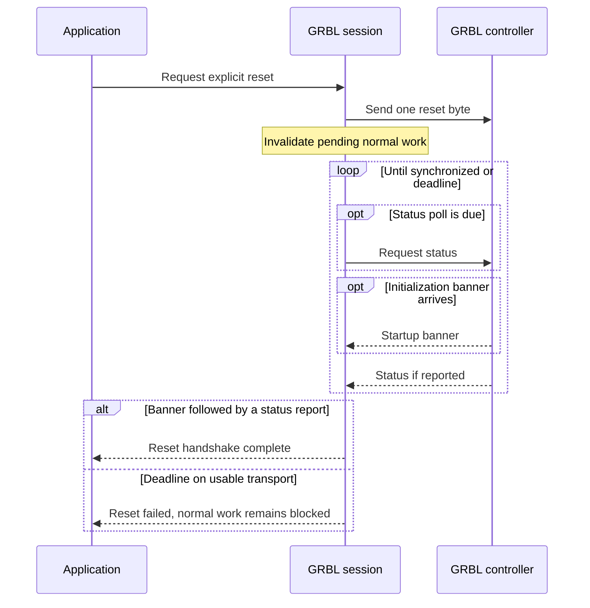

# GRBL transports and machine session

The machine packages in `:infrastructure` implement the GRBL communication
boundary. The [application connection](controller-connection.md) owns session
lifetime and [aggregates traffic](controller-connection.md#traffic-aggregation-and-retention)
from the session events documented here.

## Transport lifecycle

The `MachineTransport` contract
defines a one-shot byte connection. `TcpTransport` implements cancellable
non-blocking TCP with bounded connect/write timeouts, EOF detection and
idempotent close. `SerialTransport` uses jSerialComm with explicit port, baud,
data/stop bits, parity, flow control and DTR/RTS configuration. Non-blocking
serial reads/writes allow cancellation and bounded write deadlines. Native open
is dispatched to the I/O pool. USB disconnect notifications invalidate the
transport. `MachineTransport.isConnected` reports whether the transport is known
usable. It is not proof of controller responsiveness. Cancelling or timing out a
write preserves a usable connection but can leave a partial/uncertain write.
Actual I/O failures close it before propagating. Local argument rejection sends
no bytes. Native driver calls may delay cancellation until the driver returns.
Serial lifecycle tests use an injected native adapter. Physical ports are not
verified.

Serial native open seeds requested DTR/RTS levels before opening and checks both
levels after opening. This never alternates levels to generate a reset pulse.
Fake-native policy tests cover ordering and failure. Physical USB line behavior
remains unverified. Native adapter semantics follow the
[jSerialComm control-line API](https://fazecast.github.io/jSerialComm/javadoc/com/fazecast/jSerialComm/SerialPort.html).

## Protocol framing

`GrblProtocol` parses acknowledgments, numeric errors/alarms, startup
banners and status reports, retaining optional/unknown fields. Incremental
CR/LF decoding bounds each response line to 4096 bytes. Normal commands are
restricted to a nonblank line of at most 120 printable ASCII bytes. Embedded
realtime bytes are rejected.
`MachineSession` defines the application-facing connection, line acknowledgment,
real-time and status-query API. The session publishes immutable `MachineSnapshot` values via read-only
`StateFlow`. Reports include execution state, optional machine and work
positions, coordinate offset, optional and unknown fields, the observation
timestamp and explicit connection health. `ControllerStatus.executingLineNumber` exposes
the sampled `Ln` value from that report. A missing or invalid value yields
`null`. The observation does not establish acknowledgment or completion. An application must distinguish
retained observations, stale reports and live data.

## Handshake and command acknowledgment

`GrblMachineSession` owns one transport and one reader. It connects by requesting
status (`?`) until a report arrives within a bounded handshake deadline. It
never resets, unlocks or resumes a controller implicitly. Firmware startup-block
acknowledgments, NVS errors and alarms received during this status-only
handshake are retained as diagnostics, not correlated with commands. A reported
Alarm state can complete the connection handshake. Motion remains subject to
the controller state and application admission. Normal lines are
serialized with one acknowledgment outstanding. `CommandAcknowledgment` reports
acceptance or an error code, plus information lines observed during that request.
These lines may include unsolicited controller notifications. It is not an
operation-completion result. Real-time writes bypass normal admission and its
acknowledgment wait. Writes are serialized per bounded line/real-time byte,
without holding the write lock during the acknowledgment wait. A caller
dispatching a batch can capture the session's normal-command epoch and supply
it with every line. A reset, alarm or uncertain response invalidates that
epoch. The session checks it at normal-line admission, including after waiting
for an earlier line. A late acknowledgment cannot make an old epoch valid again.
The fenced `executeLine` overload calls `onSent` after a full transport write
returns successfully and before awaiting the response. If the write fails and
may have transferred bytes, it calls `onUncertainWrite` before propagating the
failure. Admission failure and known local rejection invoke neither callback.
Each session implementation supplies these signals at its write boundary.

## Alarms and command correlation

Alarm presentation, transport health and ordinary command correlation are
independent. The session populates `alarmCode` from `ALARM:n` or optional
`Alarm:n` status substates. Hold and Run substates are separate. The computed
`alarm` descriptor uses the [firmware alarm categories](grbl-alarms.md#alarm-categories).
`GrblProtocol` recognizes optional `[ALARMCODE:n||description]` metadata from
an explicit `$EA` query. It supplies `alarmDescription` when available, with a
512-entry metadata cache. Catalog queries, unlock, homing and reset require
explicit requests.

A [core-critical event](grbl-alarms.md#alarm-categories) can discard
a line without acknowledgment. The session fails active/queued normal work and
sets `resetRequired`, without waiting for a late `ok` and without closing a usable
transport. Ordinary writes remain prohibited even if an unrelated acknowledgment
or a status report arrives. Unknown numeric extension alarms require the same
conservative reset boundary, without being labelled core-critical. A bare Alarm
with no known code blocks normal writes until identified or explicitly reset.

Non-critical alarms interrupt an active line and invalidate already queued lines.
A transmitted line retains its response slot: `normalCommandsSynchronized` is
false until that line's late `ok`/`error` is consumed. The same applies to a
normal-command timeout, cancellation, response-collection overflow or uncertain
write. If no response arrives, `reset()` provides an explicit recovery path.
An alarm with no outstanding line creates no response expectation. A
non-critical alarm such as homing-required (11) permits explicitly requested
`$H` through the normal API. Repeated reports of the same Alarm state do not
interrupt that request. An `ok` does not establish homing or operation completion.
Local rejection/cancellation before write admission preserves other queued work.
A regular `error:n` rejects only its own line.

## Reset and recovery

`reset()` (also used by `sendRealtime(SOFT_RESET)`) sends one explicit reset byte (`0x18`)
on the existing transport, invalidates pending/queued work and waits under a
bounded deadline for the initialization banner and a subsequent status report.
Pre-banner statuses and acknowledgments cannot restore synchronization. The
banner is the core's parser/input-buffer reset boundary. It discards old response
expectations without replay. The session never opens another transport, retries
the reset, unlocks or homes. `resetInProgress` describes this handshake separately
from `connection`. A timeout, cancellation or uncertain reset write leaves control/status
available on a usable transport while normal work remains blocked. The operator
may clear the cause and request
another reset. A known unsent local reset rejection preserves existing work.
Unexpected initialization also preserves transport/control but requires explicit
session recovery before admitting normal work.

The session polls during reset and requires an initialization banner followed
by a status report. The diagram shows a reset attempt on a usable transport.

A critical alarm code may remain reported after reset has exited the blocking
loop. Therefore alarm criticality is not equivalent to `resetRequired`. A
retained, known pre-reset code after a confirmed reset boundary does not itself
demand a second reset, including when a bare Alarm report precedes its substatus.
This exception ends on a non-Alarm status, a changed alarm code or an explicit
`ALARM:n` event. A subsequent alarm transition is handled as a new event, even
when it repeats the pre-reset code. New critical alarms, `ALARM:n` events with
critical/unknown codes or critical-blocking status reassert the restriction.
Absence of `$C:1` does not identify a reported alarm as retained.
`ControllerStatus.blockingCriticalEvent` exposes the
[firmware blocking flag](grbl-alarms.md#explicit-reset-boundary) when available.
`STATUS_QUERY_ALL` (`0x87`) requests these fields as a grblHAL extension.
Ordinary `?` remains available on controllers without that extension.

## Realtime control and connection loss

Status and real-time writes bypass normal admission and acknowledgment waits.
The controller determines which controls it processes in each state. Critical
loops continue status/reset handling but must not be assumed to execute Feed
Hold, Cycle Start or overrides normally. No real-time error is retried.
Recoverable/local errors and cancellation preserve a usable transport and are
reported separately in `lastRealtimeFailure`. Actual I/O loss and reader/framing
failure mark the connection FAILED. A missed status response alone does not
close a usable transport. Consumers must check `reportedAt` and connection health
before treating retained observations as live. Close cancels owned coroutines.
`awaitClosed()` joins them. Parent cancellation closes the owned session.

There is no generic resynchronization guarantee from a status report, delay, empty line or
diagnostic request because ordinary responses have no request IDs. Unsolicited
acknowledgments with no owner require explicit reset. See
[grblHAL alarm protocol](grbl-alarms.md) for categories, recovery considerations,
pinned source findings and simulator versus in-memory verification coverage.

## Controller compatibility requirements

grblHAL is the primary target. Other GRBL-compatible firmware can use the
protocol where compatible. Detect or explicitly configure optional extensions
before offering their features. Availability varies by firmware build, driver
and plugins. Examples include axis and coordinate-system support, tool tables,
G65 macros and expressions, controller storage, tool changes, probing, tool
setters and optional report fields.

General capability discovery and streaming are planned. Richer machine models
may expose the active work coordinate system, feed/spindle and overrides,
tool selection, homing and probe state where the controller reports them.
The controller remains authoritative. Preserve optional or unknown fields,
and represent unavailable or stale values explicitly.

## Communication events

`MachineSession.communication` is a read-only `Flow<CommunicationEvent>`
observed at the existing coordinated session I/O boundary. No observer reads the
transport or owns acknowledgments. The reader retains each original nonempty
decoded line alongside the parsed category: status, acknowledgment, error, alarm,
startup or information (including unknown extensions). Normal TX retains its
exact encoded line including LF. Realtime/status bytes are rendered as printable
ASCII or `0xNN`. Each event has a session-local sequence and `Instant` timestamp.

TX `ATTEMPTED` means handoff to the transport, never delivery, acknowledgment or
motion completion. A failed handoff emits a related event referencing the attempt:
`LOCAL_REJECTION` guarantees no bytes were sent under the transport contract.
`UNCERTAIN` covers cancellation, timeout and I/O failure, including possible
partial writes. Session validation/admission rejection has no TX event. A write
that returns normally remains an attempt observation. Normal `ok`/`error` remains
a separate RX event owned by the existing session correlation logic.

The session retains a bounded replay buffer (256 events by default) backed by
`MutableSharedFlow` with `DROP_OLDEST` and non-suspending `tryEmit` publication.
A stalled subscriber cannot cause the latest event to be rejected for responsive
subscribers. Each subscriber resumes with the recent tail. Sequence gaps show
which observations it missed. `recentCommunication` exposes a read-only snapshot
of that bounded tail without subscribing or changing controller state.

`droppedCommunicationEvents` counts each source event evicted before handoff to
at least one active subscriber once, even if several subscribers missed it. It
is updated at publication, including the last overflow before traffic stops.
Subscriber resumption is not required. One next-sequence cursor per active
subscription supplies this information because `DROP_OLDEST` always accepts
`tryEmit`. Cursor registration/removal and advancement share the short publication
lock. Subscriber code runs outside cursor bookkeeping. A value taken from the
backing flow but evicted before cursor advancement is skipped rather than handed
out after being counted as lost. Collection uses the supported `flow` builder,
not inheritance from the unstable `SharedFlow` interface. No rejected-delivery
queue, per-subscriber event buffer or transport reader is introduced.

The aggregate drop count may include losses seen only by a different subscriber. Replay eviction without subscribers and ordinary
history retention are not subscriber overflow. Observation never changes
controller state, normal admission, status parsing, priorities or alarm handling.

## References

- [grblHAL core](https://github.com/grblHAL/core)
- [grblHAL documentation](https://www.grblhal.org/)
- [jSerialComm](https://github.com/Fazecast/jSerialComm)
