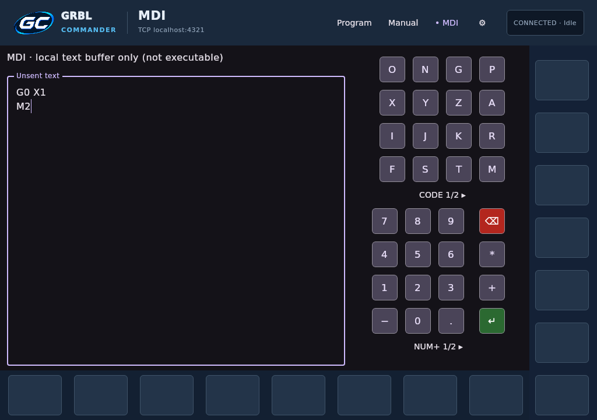
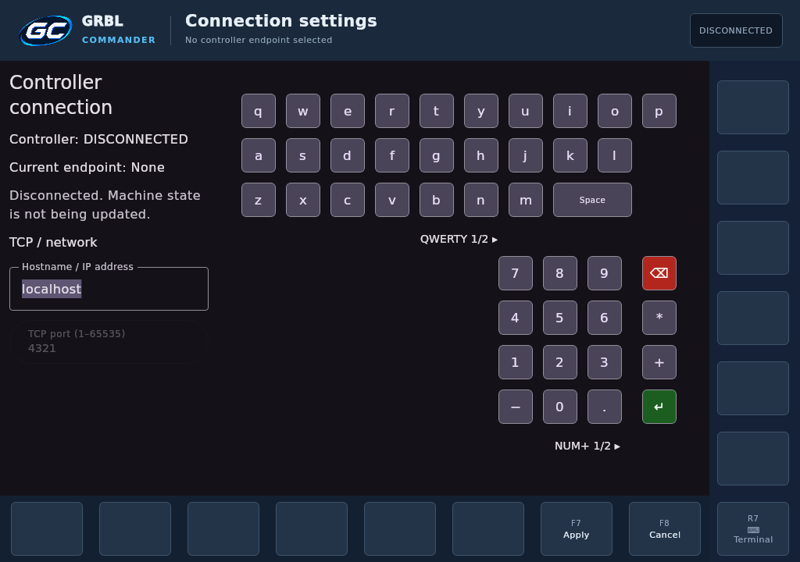

# CNC and text touch keypads

Shared renderers, keymaps and editing helpers live in desktop `ui.components.controls`. Screens own their inputs and choose how to handle keypad actions.

## Clusters and default G-code keymaps



`ui.components.controls.GCodeKeyboard` stacks the letter `KeyCluster` above the
numeric cluster in a right-hand workspace panel beside the Util Terminal console
or the local buffer owned by `mode.mdi.MdiMode`. The console/input occupies
the full available height.
Each cluster has independent retained
`KeyClusterState`, a square grid and one page-count/Next control below it, wrapping
to the first page. Single-page maps omit the page control. Paging preserves focus,
caret, selection and the other cluster's page. Empty positions retain their space.
A key can span adjacent columns in the same row. Its width includes the gaps
between those columns, and its height stays the same as other keys.
The control does not use F8/R7 or the screen-navigation mechanism.

Default letter pages (each cell lists columns 1–4):

| Row | Page 1 | Page 2 |
| --- | --- | --- |
| 1 | `O N G P` | `B C D E` |
| 2 | `X Y Z A` | `H L Q U` |
| 3 | `I J K R` | `V W` then two empty slots |
| 4 | `F S T M` | Four empty slots |

Default numeric/operator pages:

| Row | Page 1 | Page 2 |
| --- | --- | --- |
| 1 | `7 8 9 ⌫` | `# / = ⌫` |
| 2 | `4 5 6 *` | `( ) $ *` |
| 3 | `1 2 3 +` | `[ ] % +` |
| 4 | `− 0 . ↵` | `− Space : ↵` |

Minus inserts ASCII `-`. Space inserts one space. Backspace and Enter stay at
slots 3 and 15 on both numeric pages. Backspace has a red background and Enter
has a green background, both with white symbols. Colors follow the typed action
rather than the label or position, including custom keymaps. `*` and `+` stay at
slots 7 and 11.

## Sizing and spacing

Each ordinary key uses one [workspace grid unit](layout-grid-unit.md#workspace-grid-unit)
per side. `GCodeKeyboard`, `KeypadPanel` and `KeyCluster` accept an explicit
`keySize` to override the shared unit for an instance. The screen supplies the
actual space available to its keypad panel.

Configured ordinary row and column gaps default to 30% of the rendered key
size, with a total 60% gap before the numeric action column. A spanning key
includes the rounded gaps between its columns.

The keypad panel aims for **30 dp** around the group and reduces the margin
symmetrically on a constrained axis. Its page controls have a 44 dp minimum
height, with up to 8 dp of space above each and up to 16 dp between clusters,
depending on available height. The clusters share a right edge, and the group
aligns to the bottom right of the panel when it fits. The panel scrolls on
each axis where the grids and page controls exceed the available space at the
shared size.

At the minimum supported **1024×720 viewport**, Terminal and MDI have 532 dp
of height for the panel. At 1× scale, their two 44 dp grids and page controls
need 518 dp, leaving 7 dp for each vertical margin. Terminal and MDI allow up
to 40% of workspace width, capped at 400 dp, for the keys and page controls,
with the margin outside that budget.

## Keymap configuration

`KeypadLayout` is a copied configuration snapshot with rows/columns, a list of
row-major slot maps, labels, typed actions, ordinary spacing and optional total
gaps before columns. `Keymaps` supplies defaults. For customization, construct
screen-owned states and pass them to the same renderer. No renderer changes are
needed. For example:

```kotlin
val customLetters = KeyClusterState(KeypadLayout(
    name = "Macros", rows = 2, columns = 3,
    pages = listOf(mapOf(0 to KeypadKey("G65", KeypadAction.Insert("G65 ")))),
    spacing = .30f, gapsBeforeColumns = mapOf(2 to .60f),
))
// From a retained screen composition:
GCodeKeyboard(onAction = ::handleInput, letters = customLetters)
```

`KeyClusterState` belongs to one cluster/owner. Keep supplied instances stable.
Construct a replacement to install another layout. Default states are remembered
inside the retained composition. Maps and page choices are in memory only. There
is no visual keymap editor or persistent UI-preferences schema. Controller endpoint
settings and their persistence do not own keyboard preferences.

## Editing and input

The renderer reports `Insert`, `Backspace`, or `Enter` intentions through a required
runtime callback. Every owner explicitly binds Enter to its input's semantics.
There is no synthesized OS key event or global input dispatcher. Keys/page controls
cannot acquire text-input focus. Each key/page retains its interaction source.
A click remains valid when the pointer moves slightly inside the pressed key.
Leaving the key, cancelling the gesture or covering the screen cancels it.
First input is supported without a prior hover, including after command
acknowledgment or movement completion. `editWithKeypad` is an optional input-side helper
for insertion/selection replacement and Backspace at the caret, including a
supplementary Unicode code point. An explicit edit finalizes IME composition.
Enter always invokes the supplied binding rather than inserting text implicitly.
Physical keyboard, mouse selection, paste and touch remain Compose input behavior.
[Terminal submission](terminal.md#console-and-prompt) is an example of a
screen-owned Enter binding. MDI binds Enter to local newline
insertion. It cannot execute the buffer. No keyboard control communicates with a
session/transport or triggers realtime/motion controls.

## Connection field keymaps



Connection settings use single-page NUM for numeric fields, and two-page QWERTY
(lowercase and uppercase) stacked above NUM+ for host and device fields. Both
letter pages have a double-width Space beside N and M. NUM+ is also used beside
the CODE cluster in Terminal and MDI. Switching fields keeps the shared key
size. Physical entry and paste can supply characters outside the touch maps.

[Example of the single-page NUM keypad in the TCP port field](https://raw.githubusercontent.com/skasti/grbl-commander/pr-assets/main/connection-port-input/1024x720.png).
