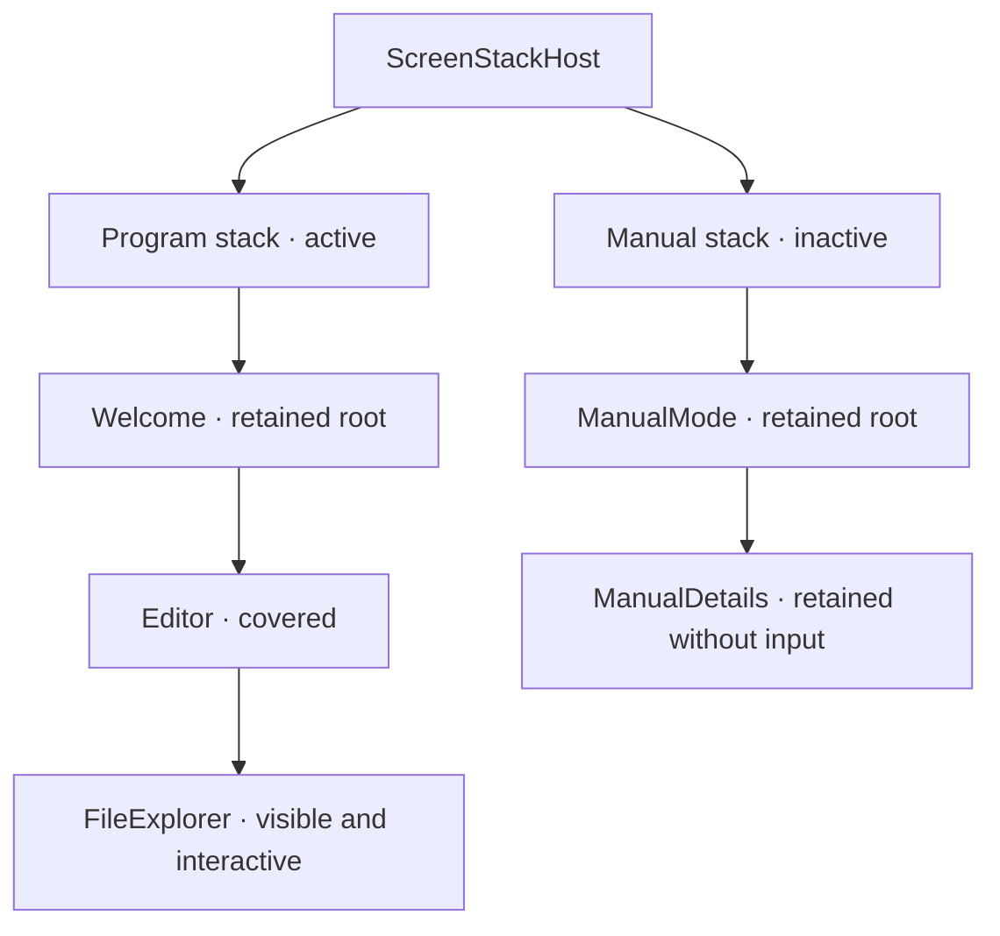

# Screen navigation and retained mode stacks

The desktop `ui.navigation` package owns these contracts. The [desktop shell](ui-layout.md) supplies the workspace and selects the active stack.

## Screen navigation

`NavigationParent` exposes an owning `screenStack`. Both `ScreenStack` and
`Screen<R>` implement this interface. `ScreenStack(root)` binds the root after
the screen has been constructed. Access to `root.screenStack` before binding
fails. The root cannot be removed. An opened screen is bound to exactly one
stack until dismissed, and cannot simultaneously belong to multiple stacks. Its
`screenStack` becomes unavailable on removal.

`Screen<R>` is one screen instance with its own `Content()`, state, navigation
methods and typed result. The constructor receives its cancellation result. For
screens without meaningful results use `Screen<Unit>(Unit)`. No extra result
class is needed. A child opens with `MyScreen(...).open(this@ParentScreen) {
result -> ... }`. The parent must be bound and must be the active screen.
Covered screens cannot open new overlays or complete their own results.
A screen can call protected `finish(result)` only while it is topmost.
The stack removes the screen, detaches its binding and then delivers the typed
callback at most once. Stale and duplicate completion attempts return false.

`ScreenStack` owns screen **instances**, ordered root to top. Its Compose
snapshot state makes `top`, `size` and the read-only `screens` observable.
Call navigation on the UI thread. `push(screen)` and typed `open(screen,
onResult)` add an instance above the current top. Passing a `ScreenStack` as
the parent in `MyScreen().open(stack) { ... }` does the same, even if another
screen is already displayed. This is an intentional direct-stack action rather
than navigation initiated by a covered screen. `pop()` returns the removed
instance, or null at the root. `dismiss(screen)` only removes that exact
topmost non-root instance. Both ordinary removal methods deliver the screen's
cancellation result before returning. Screens are compared by identity even if
their `equals` methods agree. Different stacks have independent binding,
results, and UI histories.

`ScreenStackHost` stays inside the persistent shell workspace. It renders
`Content()` without injecting navigation dependencies. Every entry remains
composed, keyed by an identity entry, in root-to-top drawing order. Each overlay
fills the workspace input region and draws a dark scrim above the preceding
screen. Its visible content may occupy only part of that region. Covered screens
retain their instance, callbacks, ordinary Compose `remember` state, and
composition effects. Popping disposes only the removed entry. A later push of
that instance starts a fresh composition while its instance-owned state
survives.

Only the top screen of the active mode receives workspace pointer and keyboard
input. Full-workspace background pointer targets behind screen content prevent clicks
in overlay margins from reaching lower siblings. The active screen's child
gestures remain unconsumed by the host, including small pointer movements while
a key is held. Covered layers consume pointer events in the Initial pass before
their children. Covered focus groups reject focus entry and key preview handlers block
stale focused descendants. Covered content is removed from accessibility
semantics. Focus returns to the active layer, not necessarily the previously
focused editor field. The header and softkeys stay outside this input boundary.

## Independent mode stacks

`CommanderApp` creates a stable `Map<OperatorMode, ScreenStack>` with
`remember(connection)`, one stack per mode in each window for that connection owner. It keeps `activeMode`
in ordinary Compose state. The selected mode controls the header and selects
`activeStack` for the workspace. Switching it never pops, finishes or
reconstructs another mode's stack. Each stack independently owns its root,
open screens, overlays and typed callbacks. There is no global navigator or
implicit redirection to the visible stack: `screen.open(parent)` resolves
the bound stack and `screen.open(stack)` uses the explicit stack even if
it is inactive.

`ScreenStackHost(stacks, activeStack)` composes all supplied stacks using
stable stack identities and reuses the single-stack rendering/input logic.
Only the active stack is drawn. Inactive stacks remain in the composition,
are removed from accessibility semantics, reject pointer/keyboard input and
cannot enter or steal focus. Reactivation focuses the current top screen after
clearing focus from the previous stack. Screen instances, nested overlay
compositions and ordinary non-saveable Compose `remember` state survive mode
changes. Popping an overlay disposes only that overlay. Closing the window
disposes its stacks and compositions. State is not persisted across restarts.

The diagram shows one window with Program selected and two overlays stacked
above its root. Manual retains its open screen while Program receives input.



Visual overlay/input behavior does not determine softkey inheritance. The active
stack resolves each softkey bank from its retained screen instances. Shell
shortcuts and pointer input operate only on that active stack. Inactive stacks
retain their own keys and screen state without receiving actions.

## Screen-owned typed results

The editor's file selection uses the actual `FileExplorer` screen, without a
facade, navigator, CompositionLocal, or generic result casts:

```kotlin
class FileExplorer(initialDirectory: String) :
    Screen<FileExplorerResult>(FileExplorerResult.Cancelled) {
    @Composable
    override fun Content() { /* file selection UI */
    }

    fun selectFile(filename: String) {
        finish(FileExplorerResult.Selected(filename))
    }
}

// Inside Editor:
FileExplorer("/programs").open(this@Editor) { result ->
    when (result) {
        is FileExplorerResult.Selected -> loadExampleFile(result.filename)
        FileExplorerResult.Cancelled -> Unit
    }
}

// A host may also open directly on its own stack:
FileExplorer("/programs").open(programStack) { result -> /* ... */ }
```

The concrete example screen and its files are in-memory UI fixtures. Opening
through a screen automatically resolves that screen's bound stack. Direct-stack
opening uses the given stack. A detached or covered screen cannot be an active
navigation parent. Typed completion restores the parent screen before invoking
its callback. Cancelling explicitly, pressing back or calling `pop()` delivers
the same `Cancelled` result.

## Runnable example

`mode.program` owns `Welcome`, `Editor`, `FileExplorer`, the typed explorer
result and the example file fixtures. In **Program** mode, choose **Open
navigation example** on the welcome screen, edit the draft, then choose **Open
example file**. Each invocation creates a `FileExplorer` screen
instance. **Cancel** or `pop()` restores the same editor and leaves its draft
unchanged. Clicking a fixture selects it without closing the explorer. **Select
file** or **F1 Select** delivers `Selected(filename)`. The editor looks up the
in-memory fixture and updates its filename and draft. **Back to
welcome** completes the editor's `Unit` result. The welcome screen's F1 opens
the editor. The editor's F1 opens a file explorer
and F8 returns to welcome. Explorer F1 Select and F2 Clear selection enable only
when a fixture is selected. F8 cancels. Explorer replaces the entire bottom bank
but inherits the editor's right bank. In the in-memory example, the editor also
offers Open file (R1) and Back (R2). While the explorer is open, its R1 modifier
relabels and disables the inherited editor Open file action, R2 explicitly
blanks the inherited Back action, and R7 Info (Shift+F7) toggles its active
presentation and fixture information. Closing the explorer restores the
editor's definitions automatically. These are stable per-instance definitions
with bound callbacks and snapshot-state predicates. The example has no access to local or controller files and cannot execute G-code.

`mode.manual` owns `ManualMode` and `ManualDetails`, including its temporary
notes. While the explorer is open, use the header to select **Manual**, open **Manual
details**, and optionally type local notes. Return to **Program**: the same
explorer, editor instance and draft are available. Dismiss or select a file
to deliver the typed result. The Manual details screen remains open when
switching back. **MDI** contains an unsent, local text buffer. The examples are
deliberately disconnected from any controller. They neither simulate jogs nor
expose motion operations.

See [Dialogs](dialogs.md) for typed modal choices and [Workspace sizing and softkeys](layout-grid-unit.md#screen-owned-softkey-contract) for the rules that select actions from a stack.
