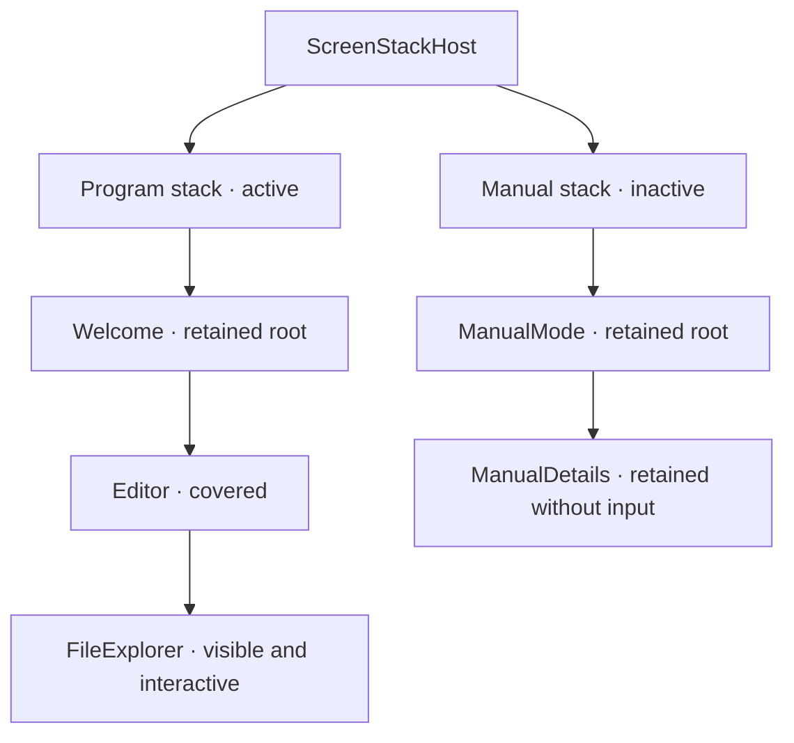
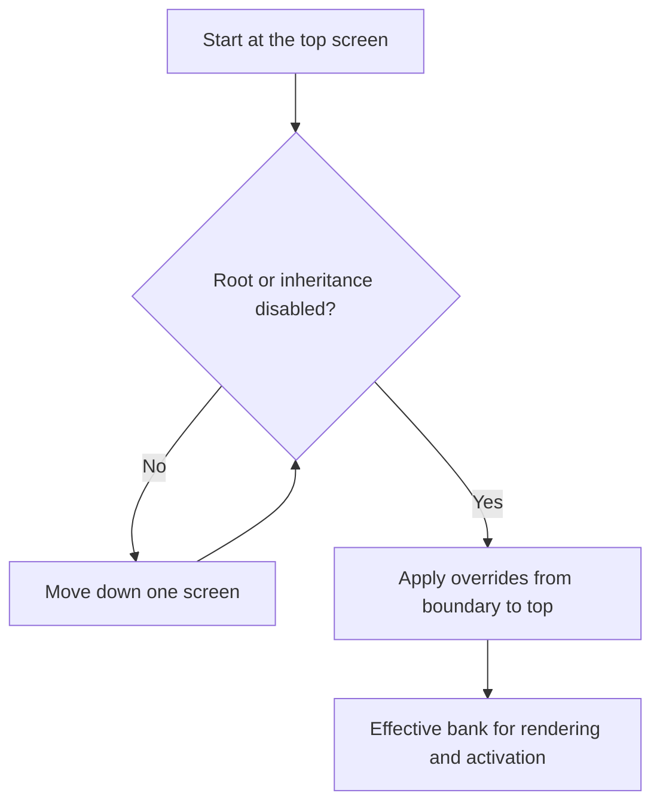

# Screen navigation and softkeys

The desktop `ui.navigation` package owns these contracts. The [desktop shell](ui-layout.md) supplies the workspace and selects the active stack.

## Screen navigation

`NavigationParent` exposes an owning `screenStack`. Both `ScreenStack` and
`Screen<R>` implement this interface. `ScreenStack(root)` binds the root after
the screen has been constructed. Access to `root.screenStack` before binding
fails. The root cannot be removed. An opened screen is bound to exactly one
stack until dismissed, and cannot simultaneously belong to multiple stacks. Its
`screenStack` becomes unavailable on removal.

`Screen<R>` is one screen instance with its own `Content()`, state, navigation
methods and typed result. The constructor receives its cancellation result. For
screens without meaningful results use `Screen<Unit>(Unit)`. No extra result
class is needed. A child opens with `MyScreen(...).open(this@ParentScreen) {
result -> ... }`. The parent must be bound and must be the active screen.
Covered screens cannot open new overlays or complete their own results.
A screen can call protected `finish(result)` only while it is topmost.
The stack removes the screen, detaches its binding and then delivers the typed
callback at most once. Stale and duplicate completion attempts return false.

`ScreenStack` owns screen **instances**, ordered root to top. Its Compose
snapshot state makes `top`, `size` and the read-only `screens` observable.
Call navigation on the UI thread. `push(screen)` and typed `open(screen,
onResult)` add an instance above the current top. Passing a `ScreenStack` as
the parent in `MyScreen().open(stack) { ... }` does the same, even if another
screen is already displayed. This is an intentional direct-stack action rather
than navigation initiated by a covered screen. `pop()` returns the removed
instance, or null at the root. `dismiss(screen)` only removes that exact
topmost non-root instance. Both ordinary removal methods deliver the screen's
cancellation result before returning. Screens are compared by identity even if
their `equals` methods agree. Different stacks have independent binding,
results, and UI histories.

`ScreenStackHost` stays inside the persistent shell workspace. It renders
`Content()` without injecting navigation dependencies. Every entry remains
composed, keyed by an identity entry, in root-to-top drawing order. Each overlay
fills the workspace input region and draws a dark scrim above the preceding
screen. Its visible content may occupy only part of that region. Covered screens
retain their instance, callbacks, ordinary Compose `remember` state, and
composition effects. Popping disposes only the removed entry. A later push of
that instance starts a fresh composition while its instance-owned state
survives.

Only the top screen of the active mode receives workspace pointer and keyboard
input. Full-workspace background pointer targets behind screen content prevent clicks
in overlay margins from reaching lower siblings. The active screen's child
gestures remain unconsumed by the host, including small pointer movements while
a key is held. Covered layers consume pointer events in the Initial pass before
their children. Covered focus groups reject focus entry and key preview handlers block
stale focused descendants. Covered content is removed from accessibility
semantics. Focus returns to the active layer, not necessarily the previously
focused editor field. The header and softkeys stay outside this input boundary.

## Independent mode stacks

`CommanderApp` creates a stable `Map<OperatorMode, ScreenStack>` with
`remember(connection)`, one stack per mode in each window for that connection owner. It keeps `activeMode`
in ordinary Compose state. The selected mode controls the header and selects
`activeStack` for the workspace. Switching it never pops, finishes or
reconstructs another mode's stack. Each stack independently owns its root,
open screens, overlays and typed callbacks. There is no global navigator or
implicit redirection to the visible stack: `screen.open(parent)` resolves
the bound stack and `screen.open(stack)` uses the explicit stack even if
it is inactive.

`ScreenStackHost(stacks, activeStack)` composes all supplied stacks using
stable stack identities and reuses the single-stack rendering/input logic.
Only the active stack is drawn. Inactive stacks remain in the composition,
are removed from accessibility semantics, reject pointer/keyboard input and
cannot enter or steal focus. Reactivation focuses the current top screen after
clearing focus from the previous stack. Screen instances, nested overlay
compositions and ordinary non-saveable Compose `remember` state survive mode
changes. Popping an overlay disposes only that overlay. Closing the window
disposes its stacks and compositions. State is not persisted across restarts.

The diagram shows one window with Program selected and two overlays stacked
above its root. Manual retains its open screen while Program receives input.



Overlay input isolation and [softkey inheritance](#screen-owned-softkey-contract)
are independent. The active stack provides the shell's bindings.

## Softkey placement

Use the shell's [bottom and right softkey banks](ui-layout.md#persistent-shell)
for most screen actions so operators can find them in consistent positions.

| Bank | Prefer for |
| --- | --- |
| Bottom (F1–F8) | Actions for the current task, such as selecting an option, confirming a dialog, or operating the Terminal. |
| Right (R1–R7) | Navigation between related screens and controls that should stay available across bottom pages. |

Keep common actions in the same slot across pages. Use workspace controls for
direct interaction with content, such as editing text or selecting a row.
A touch target in the workspace can also invoke the same action as a softkey.

## Screen-owned softkey contract

`Screen<R>` owns stable `bottomKeys` and `rightKeys` maps keyed by
`BottomSoftKeySlot` (F1–F8) and `RightSoftKeySlot` (R1–R7). Values implement
`SoftKeyOverride`: immutable `SoftKeyDefinition` values hold a label, optional
Compose `ImageVector`, nullable bound action, and enabled/active predicates
(default true/false). `SoftKeyDefinition.Blank` has no label, icon or action
and is disabled. There is no visibility flag. Disabled labelled definitions
retain their content. `SoftKeyModifier` transforms a definition, typically with
`copy`, preserving callbacks and predicates unless explicitly replaced.
Screens should create definitions once and let predicates read instance state.
Ordinary predicate changes recompose the tiles without replacing their bindings
or reconstructing their maps. When a definition/override genuinely changes,
use a `mutableStateMapOf` for individual slot updates or return a map from a
`mutableStateOf(mapOf(...))`-backed property. Ordinary mutable maps or non-state
property changes do not schedule Compose recomposition and must not be used to
change softkeys. Otherwise the displayed definition can remain stale. Modifiers
should also be stable screen-owned instances. Replace an observable override
when their composition changes.
`Screen<R>` independently declares `inheritBottomKeys` and
`inheritRightKeys`, both false by default. The `definitions()`, `applyOverrides()` and `applyAllOverrides()` map
extensions compose screen-owned maps. Each bank walks from the top
down to the first screen that does not inherit that bank, or to the root.
From that boundary, definitions replace bindings and modifiers transform
existing definitions in root-to-top order. A modifier with no existing
definition is a no-op. An explicit `SoftKeyDefinition.Blank` replaces an
inherited action with a blank, non-actionable key. Undefined slots are also
blank. A screen may inherit only one bank. A fullscreen screen and an overlay
follow the same rules.

The stack performs this traversal separately for the bottom and right banks.



`ScreenStack.softKeyDefinition(slot)` reads the current effective binding when
an action is activated. `AppShell` renders from `effectiveBottomKeys` and
`effectiveRightKeys`, which are read-only `derivedStateOf` maps for each bank.
These memoize structural composition until navigation or observable overrides
change. Predicate updates alone leave the composed definitions intact. Since
rendering and activation use the same effective binding, structural softkey
updates must be observable to Compose. Neither the stack nor shell keeps a
separate mutable copy.
Screen-owned callbacks and predicate closures remain attached to their
original screen unless a modifier explicitly replaces them. Pushing,
popping and mode selection select the current effective bindings without
saving/restoring any callback state.
`AppShell` uses the same `SoftkeyTile` for both banks, preserving all eight
bottom
and seven right positions and their dimensions. Blank tiles contain no text or
icon, including shortcut hints. Disabled labelled tiles retain label, icon and
hint. Active tiles use an accent outline/background and selected semantics.
Compose evaluates enabled/active predicates during composition, observing state
reads even when a modifier has retained the predicates from another definition.

Pointer and keyboard input both call `activateSoftKey(currentStack, slot)`.
It resolves the currently active stack's effective definition at activation
time, then checks its action and latest `enabled` state. It never stores a
callback or compares a captured binding identity, and a callback is free to
navigate during its own execution. `active` does not authorize an action.
For pointer gestures `SoftkeyTile` uses Compose's
`key(stack, entry, definition)`:
the selected stack, existing top navigation entry and effective definition
determine the clickable composition's lifetime. On a visible navigation,
mode or definition change Compose disposes the old gesture so releasing it
does not click the new action. Reopening the same screen produces a fresh
navigation entry. The effective definition uses its ordinary data-class
equality, so a modifier-produced equivalent `copy()` does not churn the
gesture key. Predicate-result changes only update the rendered presentation.
No independent softkey lifecycle or identity model is kept. All navigation
and activation run on the UI thread.

F1–F8 activate the bottom bank. Shift+F1–F7 activate R1–R7. Shift+F8 and
shortcuts
with Ctrl, Alt or Meta are unmapped. The shell handles mapped key-down events
and
consumes their key-up events, even for blank/disabled slots, before workspace
children can process them. Definitions default to repeatable key-down activation. `repeatable = false`
consumes repeated key-downs until physical release. Terminal realtime actions use
this option. The shell remembers physical keys across navigation, preventing held
keys from activating a replacement binding. Owners also guard in-flight requests.
Hardware-panel integration is planned and should use the same slot activation function.

Inherited definitions follow the same reactive rules. An inactive stack
can be inspected. Shell activation always targets the active stack.

## Softkey pages

When a bank needs several sets of contextual actions, group related actions
into pages. Use **F8** to page the bottom bank and **R7** to page the right
bank when that bank is paginated. The **Next page** softkey shows the current
page and total, such as **1/2**, and wraps from the last page to the first.
A single page has no paging button. Common actions keep their slots on
every page.

`SoftKeyPages<S>` owns page state for one screen and one bank. Pass the
reserved slot as `nextSlot`, supply fixed bindings as `commonKeys`, and
expose its observable `keys` through `bottomKeys` or `rightKeys`. Page
bindings cannot reuse the paging slot or replace common bindings. Paging
uses the usual stack resolution, inheritance and guarded activation rules.
The paging action ignores keyboard repeat. Each screen and bank retains its
own page state.

## Screen-owned typed results

The editor's file selection uses the actual `FileExplorer` screen, without a
facade, navigator, CompositionLocal, or generic result casts:

```kotlin
class FileExplorer(initialDirectory: String) :
    Screen<FileExplorerResult>(FileExplorerResult.Cancelled) {
    @Composable
    override fun Content() { /* file selection UI */
    }

    fun selectFile(filename: String) {
        finish(FileExplorerResult.Selected(filename))
    }
}

// Inside Editor:
FileExplorer("/programs").open(this@Editor) { result ->
    when (result) {
        is FileExplorerResult.Selected -> loadExampleFile(result.filename)
        FileExplorerResult.Cancelled -> Unit
    }
}

// A host may also open directly on its own stack:
FileExplorer("/programs").open(programStack) { result -> /* ... */ }
```

The concrete example screen and its files are in-memory UI fixtures. Opening
through a screen automatically resolves that screen's bound stack. Direct-stack
opening uses the given stack. A detached or covered screen cannot be an active
navigation parent. Typed completion restores the parent screen before invoking
its callback. Cancelling explicitly, pressing back or calling `pop()` delivers
the same `Cancelled` result.

## Runnable example

`mode.program` owns `Welcome`, `Editor`, `FileExplorer`, the typed explorer
result and the example file fixtures. In **Program** mode, choose **Open
navigation example** on the welcome screen, edit the draft, then choose **Open
example file**. Each invocation creates a `FileExplorer` screen
instance. **Cancel** or `pop()` restores the same editor and leaves its draft
unchanged. Clicking a fixture selects it without closing the explorer. **Select
file** or **F1 Select** delivers `Selected(filename)`. The editor looks up the
in-memory fixture and updates its filename and draft. **Back to
welcome** completes the editor's `Unit` result. The welcome screen's F1 opens
the editor. The editor's F1 opens a file explorer
and F8 returns to welcome. Explorer F1 Select and F2 Clear selection enable only
when a fixture is selected. F8 cancels. Explorer replaces the entire bottom bank
but inherits the editor's right bank. In the in-memory example, the editor also
offers Open file (R1) and Back (R2). While the explorer is open, its R1 modifier
relabels and disables the inherited editor Open file action, R2 explicitly
blanks the inherited Back action, and R7 Info (Shift+F7) toggles its active
presentation and fixture information. Closing the explorer restores the
editor's definitions automatically. These are stable per-instance definitions
with bound callbacks and snapshot-state predicates. The example has no access to local or controller files and cannot execute G-code.

`mode.manual` owns `ManualMode` and `ManualDetails`, including its temporary
notes. While the explorer is open, use the header to select **Manual**, open **Manual
details**, and optionally type local notes. Return to **Program**: the same
explorer, editor instance and draft are available. Dismiss or select a file
to deliver the typed result. The Manual details screen remains open when
switching back. **MDI** contains an unsent, local text buffer. The examples are
deliberately disconnected from any controller. They neither simulate jogs nor
expose motion operations.

See [Dialogs](dialogs.md) for typed modal choices.
