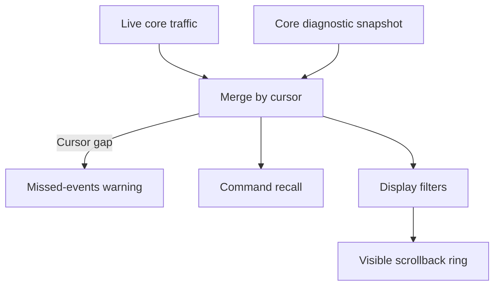

# Util Terminal and traffic diagnostics

Terminal is the [Util root](controller-connection.md#util-navigation).
The console observes traffic and submits explicit operator actions through
the shared connection.

## Console and prompt

The workspace has compact endpoint/controller status, a dark virtualized monospaced
output region and an editable `>` prompt inside the same console surface. Output
entries distinguish TX, RX, category,
timestamps and failed/uncertain handoffs. Original unfamiliar text is retained.
Control characters are escaped. Selection and copying are supported within one
output entry. Selection spanning multiple lazy entries is not implemented.

The `>` prefix and editable line share font metrics and vertical alignment.
The entire 48 dp prompt is a focus target.

Incoming events never replace the prompt value, caret or focus. Ordinary
text editing, selection and paste use Compose text input. Enter or the onscreen
keyboard Done/Enter action is the only submission action. Held Enter and concurrent
IME/key submission cannot duplicate a pending request. The prompt applies the
[normal-line validation rules](grbl-session.md#protocol-framing) and the
[core admission checks](controller-connection.md#manual-command-admission).
Local admission or failure feedback appears beneath the prompt. A failed
submission preserves the draft. Success clears the
unchanged line after acknowledgment, without claiming motion completion. Up/Down
and F3/F4 on the first bottom-softkey page browse up to 100 recent transport handoffs
and restore the unsent draft. See [command recall ingestion](#terminal-subscription-and-recall).

## Traffic filters

F7 **Filters**, with a funnel icon, replaces the current bottom bank with a
contextual filter menu. F7 **↩ Back** restores the previously selected bottom
page. Paging is unavailable while filtering. Util navigation remains available.
Input, scrollback and filter values are unchanged. There is no Show all action
and no filter buttons in the workspace.

| Bottom slot in Filters | Filter/action | Initially visible |
| --- | --- | --- |
| F1 | Status RX | No |
| F2 | Poll TX | No |
| F3 | OK | Yes |
| F4 | Info and startup | Yes |
| F5 | Errors and alarms | Yes |
| F6 | Time | Yes |
| F7 | Back | Restores the selected ordinary page |
| F8 | Unassigned | No paging behind the menu |

Active filters mean visible. Normal/realtime commands always remain visible.
The display filter applies on receipt and leaves session processing and shared
alarm and connection indicators untouched.

## Realtime controls and softkey pages

### Bottom softkeys

The softkeys along the bottom of the Terminal provide command controls, history
navigation, and log actions.

| Bottom softkey | Page 1 | Page 2 |
| --- | --- | --- |
| F1 | ▶️ Cycle Start. Sends `~` when [core admission](controller-connection.md#manual-command-admission) permits it. | 🔄 Soft Reset. Asks for confirmation before resetting the controller. |
| F2 | ⏸️ Feed Hold. Sends `!` to pause motion. | Copy selected text from the log. |
| F3 | ⬆️ Prev Cmd. Recall the previous command. | 🧹 Clear view. Clear the displayed log. |
| F4 | ⬇️ Next Cmd. Move forward through command history. | |
| F7 | Open [Filters](#traffic-filters). | Open [Filters](#traffic-filters). |
| F8 | Switch to page 2. | Switch back to page 1. |

Terminal groups these actions into two pages. Use the **F8 Next page** softkey
to switch between them. It shows the current page as **1/2** or **2/2**.

History and copy actions are enabled when there is a command to recall or text
to copy, respectively. Realtime and paging actions suppress keyboard repeat.
Realtime requests reserve separate in-flight slots. Soft Reset confirmation
warns that reset interrupts work and invalidates pending commands.

### Right softkeys

**R6 ⏬ Follow** toggles whether Terminal automatically scrolls to the latest
sent or received traffic. It starts enabled, and the softkey highlights while
it is active. Turning it on jumps to the latest entry. Scrolling up pauses
Follow, and scrolling back to the bottom turns it on again.

Follow is available on both bottom softkey pages and in Filters. See
[Util navigation](controller-connection.md#util-navigation) for the R7 Connection
softkey and [modal bindings](dialogs.md#basedialog-and-modaldialog) for dialogs.

Switching modes or visiting settings retains the page, filter menu, list and
prompt.

## Terminal subscription and recall

Terminal consumes the [shared traffic stream and diagnostic snapshot](controller-connection.md#traffic-aggregation-and-retention).
It uses the [session event categories and TX outcomes](grbl-session.md#communication-events)
to render rows and update command recall.

Terminal continuously subscribes while its retained screen is composed, including
inactive modes and covered Connection settings. Subscription is established before
seeding from the diagnostic snapshot. Cursor overlap is ignored. Bounded overflow
during handoff remains detectable. The snapshot's oldest retained cursor establishes
the initial baseline, without warning about earlier normal diagnostic rotation.
Terminal owns a 10,000-entry Compose-observable indexed ring. Only events admitted
by current filters consume capacity. All events advance its loss cursor and update
command recall. Filter changes do not delete or reconstruct existing entries.
Slots and ring indices update atomically on the desktop UI dispatcher. Ingestion
yields after bounded work, and LazyColumn renders retained entries with stable
session/sequence keys. Only cursor gaps show a missed-events warning. Normal rotation is silent and
stable row identities preserve scrollback. Clear view advances a local history
boundary and clears only displayed rows. Session state, pending commands and
core history are unaffected. Persistent/file logging is not implemented.

In-memory command recall records ordinary command TX handoffs before acknowledgment.
Local transport rejection removes its exact session/attempt entry. Controller error,
timeout and uncertain handoff retain it. The command operation still awaits its
acknowledgment. No synthetic TX echo, automatic retry or replay is introduced.
