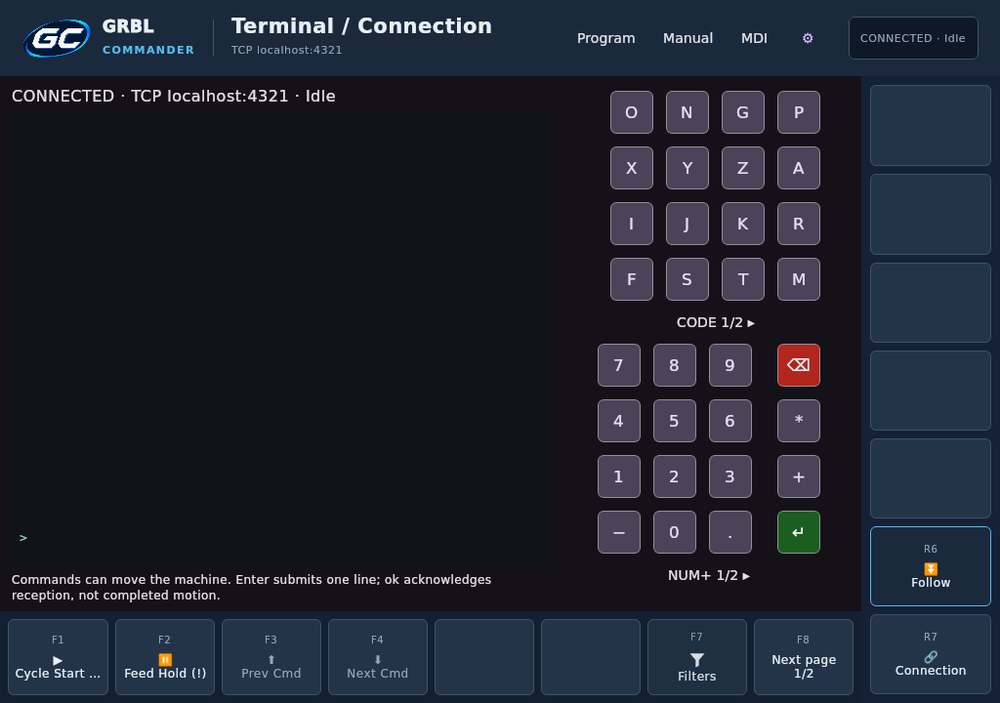

# Compose UI screenshots

## Local capture

Capture the welcome screen, Terminal, MDI and connection settings locally with
[JDK 21 and Gradle 9.8.2](testing.md#prerequisites):

```bash
gradle :app-desktop:test -PuiScreenshots \
  --tests 'no.grblcommander.desktop.mode.mdi.MdiModeTest' \
  --tests 'no.grblcommander.desktop.mode.utils.terminal.TerminalTest' \
  --tests 'no.grblcommander.desktop.mode.utils.connection.*'
```

The opt-in test task uses up to two parallel test JVMs and writes PNGs to
`app-desktop/build/ui-screenshots/<scenario>/<width>x<height>.png`.
It uses the production Compose shell, welcome screen, Terminal/MDI screens, connection forms and
editors, and deterministic in-memory controller/discovery fixtures. The headless Skiko test surface uses software
rendering at 1× density. It captures the application client area, so native
window decorations, platform font rendering and scaled displays can differ.
The tests check keyboard paging, command submission and input focus separately
from capture. PNGs are for visual inspection. Capture ownership is recorded alongside
the images so PR review selection can include modified capture tests without
hardcoding scenarios in CI. The connection capture tests in `mode.utils.connection`
own their checkpoints by flow.

The following table lists the implemented capture set. See
[screenshot coverage requirements](#screenshot-coverage-for-ui-changes)
when changing visible UI.

| Directory | Captured state |
| --- | --- |
| `welcome` | Program welcome screen at startup |
| `terminal` | Util Terminal with the first letter and number pages |
| `terminal-page-2` | Both second pages with a focused command draft |
| `terminal-acknowledged` | Command acknowledged while simulated execution is Run |
| `terminal-idle-first-letter` | Idle following Run and the first post-command keypress |
| `mdi` | New-line draft and saved MDI line with the DRO placeholder and first keypad pages |
| `mdi-page-2` | MDI line with an unsaved replacement and the second keypad pages |
| `mdi-running` | Eight-line MDI program with active execution, last sent and edit selection on separate rows |
| `mdi-running-markers-overlap` | Executing and last sent refer to the same row, with only the executing marker visible |
| `mdi-running-display-off` | Running MDI program with all three display toggles off |
| `mdi-held` | Controller Hold with Resume available and an unknown active line |
| `mdi-reset-confirmation` | Soft Reset confirmation during an MDI run |
| `mdi-rejected` | Controller rejection identifying the failed MDI line |
| `mdi-start-blocked` | Idle controller with Cycle Start blocked by a required reset |
| `connection-serial-defaults`, `connection-tcp-draft` | Serial defaults and retained TCP form |
| `connection-port-discovery-*` | Loading, empty and failed serial discovery |
| `connection-port-page-*`, `connection-port-single-page` | Six numbered device rows, paging/wrap and a partial final page; single-page bank |
| `connection-baud-page-*` | Both pages of the production common-baud selector |
| `connection-device-input`, `connection-host-input*` | Inline device entry and both QWERTY letter pages and both pages of the shared Terminal/MDI number keypad |
| `connection-port-input`, `connection-custom-baud-input` | Inline numeric entry for TCP port and custom baud |
| `connection-advanced-*` | Four grouped combinations cover every data-bit/parity/stop/flow value and both control-line levels, plus discard confirmation |
| `connection-post-connect-all-*`, `connection-post-connect-extended` | Grouped all-off/all-on choices and extended firmware query |
| `connection-*-validation`, `connection-restore-confirmation`, `connection-reset-confirmation` | Serial/TCP validation, draft restoration and explicit reset consent |
| `connection-active`, `connection-connecting`, `connection-disconnecting`, `connection-interruption-confirmation` | Live/pending lifecycle and interruption confirmation |
| `connection-disconnected-observation`, `connection-failed`, `connection-stale` | Neutral retained observations, unexpected failure and live-but-stale warning |
| `connection-saving`, `connection-saved` | Save admission/progress and successful persistence feedback |
| `connection-post-connect-progress`, `connection-post-connect-results`, `connection-post-connect-unsynchronized` | Session-owned query progress, correlated rejection/results and unsafe-correlation skip diagnostics |

## Screenshot coverage for UI changes

Every PR adding or changing visible UI functionality must add or update saved
Compose screenshot checkpoints for the affected UI as part of the same work.

- Cover each added or affected screen, modal/dialog and visually distinct state,
  including relevant toggle/selection values, expanded content, validation and
  confirmation states. Include alternative layouts or interactions when they
  materially change what the reviewer needs to inspect.
- Minimize the number of capture scenarios while covering those states. For
  independent toggles on one screen/dialog, prefer one capture with all toggles
  off and one with all toggles on, rather than a separate before/after pair for
  each toggle. For controls with more than two values, group remaining values
  into as few additional captures as possible. Use valid, reachable combinations;
  add specific combinations only when their interaction changes the visible UI.
- Minimize checkpoints, not resolution coverage: use the shared
  `runAtScreenshotSizes` and explicit `screenshot("scenario")` checkpoints so
  every scenario retains both [configured capture resolutions](#ci-capture-and-publication)
  and source metadata.
  Extend existing functional tests and deterministic fixtures wherever possible;
  do not introduce another harness or per-screen workflow configuration.
- Keep functional assertions for individual controls and their interactions.
  Grouping controls into fewer screenshots does not reduce behavioral test
  coverage, and screenshots do not replace assertions.
- Run affected capture tests with `-PuiScreenshots`, verify that the intended
  PNGs are saved and inspect representative output for legibility and clipping.
  Review the available CI artifacts/comment. Report capture or inspection that
  could not be completed instead of claiming it was verified.
- Describe the covered screens/states and any remaining gaps in the PR. Compare
  the coverage with the UI changes before considering the work complete.

## CI capture and publication

The Linux PR and main-push jobs capture each scenario at **1024×720** and
**1680×1050**, covering the [minimum viewport](ui-layout.md#persistent-shell)
and the CNC touchscreen. Windows runs the functional tests. CI capture and
publication run on Linux.

Open the workflow run's **Artifacts** section for
`compose-ui-screenshots-<attempt>` or, if Linux tests failed after saving
some PNGs, `compose-ui-screenshots-partial-<attempt>`. Artifacts are kept
for 14 days.

Successful pushes to `main` publish a complete capture set to `pr-assets/main/`
after the Linux/Windows builds, simulator integration and screenshot-tool tests
pass. Same-repository PRs publish complete Linux captures to `pr-assets/<PR number>/`
and maintain one marked review comment. A partial/failed Linux capture stays an
artifact and cannot replace published images or comments. A push to `pr-assets`
does not trigger CI, so baseline publication cannot create a workflow loop.
Fork PRs against upstream have read-only capture jobs and artifacts only; the
write-enabled publication/comment job is skipped. No upstream write token is
passed to fork code. These rules also apply within a contributor's own fork.

Publication replaces only its target directory. Non-force Git pushes retry from
the latest tip, preserving other directories. Per-target workflow run/attempt
markers prevent older runs and reruns from replacing newer assets. One job-level
concurrency group covers publication and comment updates for each PR (and a
separate group for main); the comment also checks run/attempt ordering and that
the PR is still open at the captured head. The stable bot-comment marker is
`<!-- grbl-commander-ui-screenshots -->`. Repeated publication updates that comment
rather than creating another. Rerun **all jobs** to retry capture/publication.

## Screenshots in documentation

Use the published `main/` directory on the `pr-assets` branch for images
embedded in repository documentation. This keeps the links valid when a
closed PR's screenshot directory is removed.

```markdown

```

## PR review selection

Review selection compares decoded RGBA pixels and dimensions against the main
baseline in the published asset snapshot; PNG metadata/compression do not count.
A scenario is included if any size is **new** or **changed**, or if its recorded
capture-test source is new/modified in the PR diff (**test-modified**), even with
identical pixels. `runAtScreenshotSizes` resolves the calling Kotlin test source
before starting the Compose runner and writes `<scenario>/capture-source.txt`.
Scenario names use lowercase letters/digits separated by hyphens and belong to
one test source. Connection captures are grouped by workflow so a change to a
selector or inline editor test only selects the scenarios owned by that source
for the `test-modified` reason. Adding a scenario requires only a test checkpoint,
with no CI scenario list. Screenshots from older captures without ownership
metadata still participate in pixel comparison. Removed paths are listed without
embedding a missing image. Differences are informational and never fail the build.

Each selected scenario embeds exactly one expanded image, preferring 1024×720
(or the first available size), with all other sizes under **Other resolutions**
in a collapsed details section. Identical captures are omitted unless their test
source changed. A clean comparison produces a short no-differences comment. If
`main/` is unavailable, captures are explicitly labelled new. All captured PNGs remain
in artifacts and on `pr-assets`, independently of comment selection. Comment
image URLs use the asset commit SHA to avoid stale GitHub image caches.

## Local screenshot tooling

For local selection/publisher regression tests (Python 3 and Pillow):

```bash
python -m pip install Pillow==12.0.0
python -m unittest discover -s .github/scripts -p 'test_*screenshots.py'
```

To preview a comment without a token, check out a `pr-assets` commit into an
`assets` directory, and save a JSON array of modified test paths as `changed.json`:

```bash
GITHUB_REPOSITORY=OWNER/REPOSITORY GITHUB_RUN_NUMBER=RUN GITHUB_RUN_ATTEMPT=ATTEMPT \
  python .github/scripts/review_ui_screenshots.py --assets assets \
  --commit ASSET_COMMIT_SHA --pr PR_NUMBER --changed-paths changed.json > review.md
```

RUN/ATTEMPT must match the selected PR directory's `.workflow-run`. For PR
review links, use the immutable asset commit and actual PR number:

```markdown

```

Published images persist after PR closure. Maintainers can remove a closed PR's
directory with a normal commit when its links are no longer needed. GitHub's PR
files API supplies ownership changes (at most 3,000 files); pixel selection still
works independently for larger PRs. Very large comments link secondary resolutions
instead of embedding them; if the expanded content itself exceeds GitHub's limit,
the comment links the full capture set. Capture rendering can vary with platform
and dependency versions. A live fork run is needed to verify the artifact-only path end to end.
